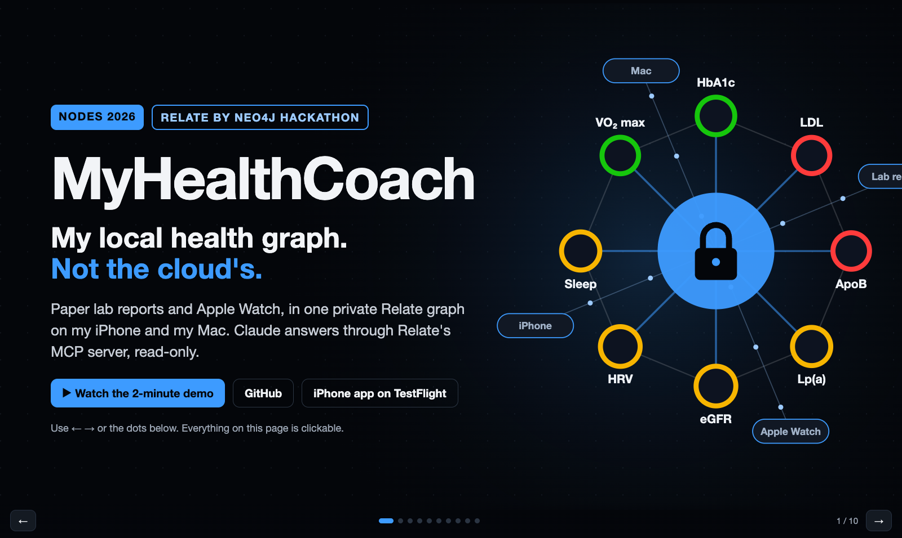
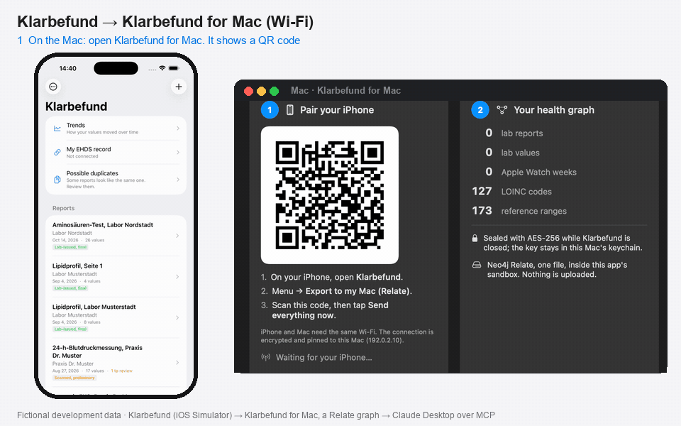

# MyHealthCoach: My Local Health Graph, Not the Cloud's

**My lab reports and Apple Watch, in one Neo4j Relate graph on my own iPhone and Mac. Encrypted, local, no cloud. Claude answers through Relate's MCP server, read-only.**

Our submission to the **[Relate by Neo4j Hackathon](https://relate.devpost.com/)** (NODES 2026).

| | |
|---|---|
| 🎬 **Demo video (2 min)** | [youtu.be/nu4nKFkpwJw](https://www.youtube.com/watch?v=nu4nKFkpwJw) · full 3-minute version: [youtu.be/HRmlXPt0r_k](https://www.youtube.com/watch?v=HRmlXPt0r_k) |
| 🖥️ **Interactive presentation** | [ma3u.github.io/relate-hackathon-team](https://ma3u.github.io/relate-hackathon-team/) |
| 🏆 **Devpost** | [MyHealthCoach on Devpost](https://devpost.com/software/myhealthcoach-my-local-health-graph-not-the-cloud-s) |
| 📱 **iPhone app (TestFlight)** | [testflight.apple.com/join/ssADSXX6](https://testflight.apple.com/join/ssADSXX6) |
| 💻 **Mac app** | [Klarbefund for Mac](docs/MAC.md): pair, seal, connect Claude with one click, no scripts |
| 🧪 **Sample graph** | [`examples/health-graph/health.rl`](examples/health-graph/health.rl), synthetic, no real person |

[](https://ma3u.github.io/relate-hackathon-team/)

## What it does

Klarbefund (iPhone) scans paper lab reports and codes every value with LOINC, with the page and line it came from. Relate, Neo4j's embedded graph database, turns them and the Apple Watch weekly means into one health graph: on the phone, and on the Mac inside an AES-256 encrypted vault. The graph also holds official and optimal reference ranges, six health risks, four published risk scores (SCORE2, eGFR, FIB-4, TyG) with the exact values they used, and the guideline sources. Claude Desktop asks it questions through Relate's MCP server, read-only, and turns it into a six-minute briefing before a doctor's visit.

Story: [docs/DEVPOST.md](docs/DEVPOST.md) · how it works: [docs/KLARBEFUND.md](docs/KLARBEFUND.md), [docs/SWIFT.md](docs/SWIFT.md), [docs/SCHEMA.md](docs/SCHEMA.md) · in plain words: [docs/EXPLAINED.md](docs/EXPLAINED.md)



### How it uses Relate

**Single-file mode.** Each person's whole health graph is one `.rl` file, so it can be encrypted as one unit to protect the personal data: on the iPhone, Klarbefund keeps it in the app's sandbox (`Application Support/HealthGraph`) under iOS Data Protection (`FileProtectionType.complete`, excluded from backup); on the Mac, `health.rl` lives inside an AES-256 encrypted disk image (`~/RelateHealth`) that is open only while in use. Relate itself does not encrypt the file; where it lives does. One file is also easy to back up encrypted, to delete for good, and to copy as a snapshot; the same Swift library (`HealthGraph`, on `RelateFFI.xcframework`) writes it on both devices, and Claude reads a read-only snapshot copy through `relate serve --mcp --read-only`.

### Try it with the sample graph

[`examples/health-graph/health.rl`](examples/health-graph/health.rl) is a single-file Relate store built from the synthetic fixtures in this repo (no real person): 3 lab reports, 16 Apple Health weekly means, and the knowledge layer (173 reference ranges, 6 health risks, 4 risk scores, 55 marker links).

```bash
relate query --database examples/health-graph/health.rl --mode table <<< \
  "MATCH (h:HealthRisk)<-[:MARKER_OF]-(:LoincCode)<-[:CODED_BY]-(o:Observation) RETURN h.name AS risk, count(o) AS values"
python -m health_graph query --db examples/health-graph/health.rl trend --param loinc=4548-4
python -m health_graph query --db examples/health-graph/health.rl ranges --param loinc=22748-8
relate serve --mcp stdio --database examples/health-graph/health.rl --read-only   # for Claude Desktop or Claude Code
```

Rebuild it: `python -m health_graph import --db health.rl fixtures/fhir/*.json`, then `python -m health_graph knowledge --db health.rl`. Setup: [docs/INSTALL.md](docs/INSTALL.md).

### Run it with your own data

The project runs on **your own devices**, with your own (or synthetic) health data that never leaves your home:

| You need | Why | Notes |
|---|---|---|
| 📱 **iPhone** (iOS 26) | Runs **Klarbefund**, which scans lab reports and reads Apple Health | Get it via **[TestFlight: testflight.apple.com/join/ssADSXX6](https://testflight.apple.com/join/ssADSXX6)** (QR code below). "Export to my Mac" reaches this public beta once its build passes Apple's Beta App Review; until then I add testers as internal testers |
| ⌚ **A wearable**: Apple Watch, **Oura Ring**, Garmin, Withings, Whoop, a smart scale … | Pulse, HRV, sleep and sleep stages, VO2 max, SpO₂, steps, weight | Anything that syncs into **Apple Health** works, since Klarbefund reads from Apple Health. Sleep stages and VO2 max need a device that records them (Apple Watch, Oura, Garmin …) |
| 💻 **Mac** (Apple silicon, macOS 26) | Runs the **Relate** graph database (Neo4j's embedded graph DB), the receiver the phone pairs with by QR code, and Claude for questions | Setup in ~10 min: [docs/INSTALL.md](docs/INSTALL.md). Relate also runs on Linux/Windows, but the encrypted-vault script and the iOS build are macOS-only |
| 📶 The **same Wi-Fi**, or a **USB cable** | The phone sends data straight to your Mac, encrypted, no cloud | Pinned TLS over Wi-Fi; no shared network (guest Wi-Fi, client isolation) → USB cable |
| 📄 *Optional:* a few **paper lab reports** | Real-world test material for the scanner | Your data stays on your devices; nothing goes into this repo |

 *Scan with the iPhone camera to join the Klarbefund beta on TestFlight.*

No iPhone? The sample graph above runs anywhere Relate runs, and Klarbefund has a demo mode with fictional data in the iOS Simulator (Mac with Xcode).


## Built with, and what was built during the hackathon

**Relate capabilities used:** the embedded engine in Swift on iOS and macOS (through `RelateFFI.xcframework`, our `HealthGraph` Swift package), the Python library (`relate-db`, the reference implementation in `health_graph/`), the `relate` CLI, single-file `.rl` stores, and `relate serve --mcp --read-only` for Claude.

**Third-party tools:** FHIR R4, LOINC, NCBI Taxonomy and the OMOP CDM as data models; swift-nio with Apple's Network framework for the pinned-TLS receiver in the Mac app (swift-nio-ssl only in the command-line receiver); ffmpeg, Playwright and headless Chrome for the video; ElevenLabs for the narration in my own cloned voice.

**AI tools (disclosed as the rules ask):** the code, docs and video were written with Claude Code (Anthropic); Claude Desktop is the assistant that queries the graph in the demo.

**Started during the hackathon (from Nov 11, 2026):** this repository: the health graph model and importer, the knowledge layer, the risk scores, the Swift library and Mac receiver, the iPhone graph and the Mac export in Klarbefund, the dashboard, the video and this presentation. **Reused, existing before:** the Klarbefund iPhone app itself (lab report scanning and LOINC coding, started March 2026, [MinimumViableHealthDataspacev2](https://github.com/ma3u/MinimumViableHealthDataspacev2)) and its reference-range table. Only the Relate integration is new.

## About Relate

Relate is an **open-source, embedded graph database for AI agents** and the engineers who build them. It runs as a library inside your app — no signup, no server.

- **Install and go** — one command adds a Relate skill to your coding agent
- **Query in process** — traverse relationships and run vector search without network calls
- **Agent-ready results** — JSON output with row limits and errors that explain how to fix them
- **Safe shared state** — transactions so multiple agents can update the same graph
- **Lightweight** — one file per graph, memory limits, delete when done
- **Connect when needed** — pull a subgraph from Neo4j, query with Cypher over MCP, Bolt, or HTTP
- **Runs in the browser** — WebAssembly build for interactive graph views
- Use it from the **CLI**, as a **Rust** or **Python** library, or via **WASM**

### Resources

- 🛠️ **Our setup guide, with screenshots: [docs/INSTALL.md](docs/INSTALL.md)** (Relate CLI, agent skill, Python, MCP, ElevenLabs)
- 📱 **Klarbefund + Apple Health → local Relate → Claude: [docs/KLARBEFUND.md](docs/KLARBEFUND.md)**
- 🍎 **Swift on iPhone and Mac, the graph on the phone itself: [docs/SWIFT.md](docs/SWIFT.md)**
- 🌐 Website: <https://relatedb.ai>
- ⚡ Quickstart / install: <https://relatedb.ai/docs/get-started/install>
- 💻 Source: <https://github.com/relatedb/relate>
- 💡 Idea list: <https://github.com/jexp/relate-ideas>
- 🏆 Devpost: <https://relate.devpost.com/> · [Rules](https://relate.devpost.com/rules) · [Schedule](https://relate.devpost.com/details/dates)
