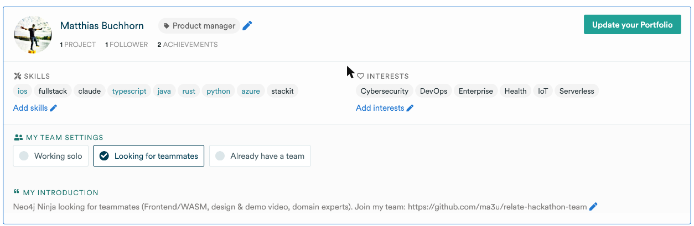

# Relate by Neo4j Hackathon — Team Up 🤝

I'm taking part in the **[Relate by Neo4j Hackathon](https://relate.devpost.com/)** and I'm **looking for 2–3 teammates** (teams can have up to 4 people).
This repo summarizes the hackathon so we can get going quickly. It will become our project repo once the team is set.

👉 **Want to join?** [Open a "Join the team" issue](../../issues/new?template=join-the-team.md) and tell me a bit about yourself, or find me ([@ma3u](https://relate.devpost.com/participants)) on Devpost.

💬 **Community:** [Neo4j Discord — "Relate by Neo4j Launch and Hackathon" event](https://discord.com/events/787399249741479977/1570141373531955240)

---

## Looking for teammates

### About me

**Matthias Buchhorn ([@ma3u](https://github.com/ma3u))**: AI & Cloud Software Engineer, Berlin (CET) · [LinkedIn](https://www.linkedin.com/in/mbuchhorn)

- 🕸️ Lots of **Neo4j / knowledge graph** work: GraphRAG for [EU regulations](https://github.com/ma3u/EU-GraphRAG) and German social law, an [EHDS health data space demo](https://github.com/ma3u/MinimumViableHealthDataspacev2), and investigation and case-file graphs
- 🤖 **Agents & memory**: [neo4j-agent-memory + MCP demo](https://github.com/ma3u/neo4j-aura-agent-memory-demo), [Haystack + Neo4j workshop](https://github.com/ma3u/haystack-workshop) (RAG, GraphRAG, agent memory), MCP servers
- 🏆 Hackathon experience: [healthgraph-agent](https://github.com/ma3u/healthgraph-agent) (Neo4j Aura Agent Hackathon 2026), SPARK Challenge
- 🛠️ Stack: Python, TypeScript, Azure; some Swift
- ⏱️ Availability: **~5 h/week** until Dec 11, so I'm looking for teammates who can help carry the build

### Who I'm looking for

**Top priorities:**

- 🌐 **Frontend / WebAssembly**: Relate runs in the browser, so we could build interactive graph views with nothing to install
- 🎬 **Design / storytelling / demo video**: Clarity is 1/5 of the score, and a demo video of up to 3 minutes is required
- 🧭 **Domain expert**: someone who brings a real problem (and ideally data) where connected context makes a difference

**Also welcome:**

- 🦀 **Rust** developers (Relate's core is Rust)
- 🐍 **Python / AI agent** builders (MCP, tool use, RAG, coding agents)

### What you need to test with us

The project runs on **your own devices**, with your own (or synthetic) health data that never leaves your home:

| You need | Why | Notes |
|---|---|---|
| 📱 **iPhone** (iOS 26) | Runs **Klarbefund**, which scans lab reports and reads Apple Health | Get it via **[TestFlight: testflight.apple.com/join/ssADSXX6](https://testflight.apple.com/join/ssADSXX6)** (QR code below). "Export to my Mac" reaches this public beta once its build passes Apple's Beta App Review; until then I add teammates as internal testers |
| ⌚ **A wearable**: Apple Watch, **Oura Ring**, Garmin, Withings, Whoop, a smart scale … | Pulse, HRV, sleep and sleep stages, VO2 max, SpO₂, steps, weight | Anything that syncs into **Apple Health** works, since Klarbefund reads from Apple Health. Sleep stages and VO2 max need a device that records them (Apple Watch, Oura, Garmin …) |
| 💻 **Mac** (Apple silicon, macOS 26) | Runs the **Relate** graph database (Neo4j's embedded graph DB), the receiver the phone pairs with by QR code, and Claude for questions | Setup in ~10 min: [docs/INSTALL.md](docs/INSTALL.md). Relate also runs on Linux/Windows, but the encrypted-vault script and the iOS build are macOS-only |
| 📶 Mac and iPhone on the **same Wi-Fi** | The phone sends data straight to your Mac, encrypted, no cloud | Guest networks with client isolation don't work |
| 📄 *Optional:* a few **paper lab reports** | Real-world test material for the scanner | Your data stays on your devices; nothing goes into this repo |

 *Scan with the iPhone camera to join the Klarbefund beta on TestFlight.*

No iPhone or wearable? You can still help: frontend/WASM, design and the demo video need only a computer, and Klarbefund has a demo mode with fictional data in the iOS Simulator (Mac with Xcode).

**How we'd work:** async, GitHub issues + PRs, a short weekly call. Ideas welcome — see [Project ideas](#project-ideas).

---

## The hackathon at a glance

| | |
|---|---|
| **Name** | Relate by Neo4j Hackathon |
| **Theme** | **"Context, Connected"** — show how connected data helps agents, apps, or people find and use the relationships that matter |
| **Sponsor** | Neo4j, Inc. — celebrating the launch of Relate at NODES 2026 |
| **Format** | Online, ~1 month, hosted on Devpost |
| **Team size** | 1–4 people; each person can only be on one team; one submission per team |
| **Eligibility** | 18+ (or age of majority), where legal. See [eligibility notes](#heads-up-the-rules-page-is-still-a-draft) for Neo4j employees |
| **Prize pool** | ~$6,197 in Apple hardware (3 winning teams) |

### Key dates

Times from the Devpost schedule (shown in CET / GMT+1):

| Phase | Start | End |
|---|---|---|
| **Submissions** | Thu, Nov 12, 2026 03:00 CET (= Wed, Nov 11, 6 PM PST) | **Sat, Dec 12, 2026 03:00 CET** (= Fri, Dec 11, 6 PM PST) |
| Public voting | Nov 12, 03:00 CET | Dec 17, 03:00 CET |
| Judging | Dec 12, 03:15 CET | Dec 17, 08:45 CET |
| Winners announced | Thu, Dec 17 (rules + Discord); the Devpost schedule widget says Dec 19, 02:00 CET | |

The Neo4j Discord announcement confirms: **submissions due Fri, Dec 11, 6 PM PST** (Sat, Dec 12, 03:00 CET), judging Dec 12–16, winners Dec 17.

> ⏰ **Practical deadline:** have everything submitted by **Friday, Dec 11 evening (CET)**.

### Prizes (marked "not yet final" in the rules)

| Place | Prize | Approx. value |
|---|---|---|
| 🥇 1st | Mac Studio M5 Max, 64 GB / 1 TB | $3,799 |
| 🥈 2nd | Mac mini M6, 32 GB / 512 GB | $1,499 |
| 🥉 3rd | Mac mini M6, 16 GB / 256 GB | $899 |

**Does every team member get a Mac? No.** Prizes are awarded **per winning entry, not per team member**: each prize is a single item, and the team names one recipient (Neo4j stays out of disputes within a team). Winners pay their own taxes and import duties.
👉 We'll agree up front, in writing, how we handle a win (for example the recipient pays the others their share of the value, or we raffle it).

**Neo4j community**: [Discord event](https://discord.com/events/787399249741479977/1570141373531955240) · docs, playground and cookbook at [relatedb.ai](https://relatedb.ai)

### Judging criteria (all weighted equally)

1. **Creativity** — how original the idea and approach are
2. **Usefulness** — how well it solves a real problem
3. **Completeness** — works end to end and runs from the setup instructions
4. **Clarity** — quality of the write-up, demo, and visual presentation
5. **Effective use of connected context** — how well it uses Relate's graph, retrieval, and agent features

---

## What we must submit

- [ ] Project title + description (what it does, why it's useful)
- [ ] **Public GitHub repo** (stays public through judging), tagged with the topic Neo4j announces (TBD, e.g. `neo4j`)
- [ ] **Setup instructions** a judge can follow to install and run it
- [ ] **Demo**: video of up to ~3 min (viewable without login) _or_ a link to a working demo; screenshots welcome
- [ ] Statement of which **Relate capabilities, third-party tools, and AI tools** we used (AI coding tools are allowed but must be disclosed)
- [ ] Disclose any reused earlier code / OSS libraries — only work done during the contest period is judged
- [ ] Project must make **meaningful use of Relate** (CLI, embedded, WebAssembly, MCP, Bolt/HTTP, hybrid retrieval, or a Neo4j/Aura connection)

---

## About Relate

Relate is an **open-source, embedded graph database for AI agents** and the engineers who build them. It runs as a library inside your app — no signup, no server.

- **Install and go** — one command adds a Relate skill to your coding agent
- **Query in process** — traverse relationships and run vector search without network calls
- **Agent-ready results** — JSON output with row limits and errors that explain how to fix them
- **Safe shared state** — transactions so multiple agents can update the same graph
- **Lightweight** — one file per graph, memory limits, delete when done
- **Connect when needed** — pull a subgraph from Neo4j, query with Cypher over MCP, Bolt, or HTTP
- **Runs in the browser** — WebAssembly build for interactive graph views
- Use it from the **CLI**, as a **Rust** or **Python** library, or via **WASM**

### Resources

- 🛠️ **Our setup guide, with screenshots: [docs/INSTALL.md](docs/INSTALL.md)** (Relate CLI, agent skill, Python, MCP, ElevenLabs)
- 📱 **Klarbefund + Apple Health → local Relate → Claude: [docs/KLARBEFUND.md](docs/KLARBEFUND.md)**
- 🌐 Website: <https://relatedb.ai>
- ⚡ Quickstart / install: <https://relatedb.ai/docs/get-started/install>
- 💻 Source: <https://github.com/relatedb/relate>
- 💡 Idea list: <https://github.com/jexp/relate-ideas>
- 🏆 Devpost: <https://relate.devpost.com/> · [Rules](https://relate.devpost.com/rules) · [Schedule](https://relate.devpost.com/details/dates)

---

## Project ideas

### ⭐ Current favorite: [Sovereign Health Graph: Klarbefund × Relate](docs/IDEA.md)

👋 **In plain words:** [Your health data, connected and kept at home](docs/EXPLAINED.md), for people without a tech or health background.

Export lab results from the Klarbefund iOS app into a **local Relate graph on the device**, using the FHIR → OMOP → ontology model of the [EHDS Integration Hub](https://ma3u.github.io/MinimumViableHealthDataspacev2/docs). Explore it privately (in the app, or with a local agent over MCP) and push to the Hub **only with explicit consent**. → [Full write-up, architecture and 4-week plan](docs/IDEA.md) · ✅ **Week 1 proof is running:** [schema & queries](docs/SCHEMA.md) · ✅ **Klarbefund + Apple Health → local Relate → Claude:** [QR pairing guide](docs/KLARBEFUND.md)

More ideas welcome via an issue or PR. Browse <https://github.com/jexp/relate-ideas> for inspiration.

---

## Heads-up: the rules page is still a draft

As of Nov 11, 2026 the published [rules](https://relate.devpost.com/rules) still contain `[Legal to confirm]` placeholders and contradict the landing page in places. Worth watching for updates:

- **New vs. existing projects** — the landing page says a project "can be new or extend something you already have"; the rules say it must be **started on or after Nov 11, 2026**.
- **Teams** — the landing page says "Hack as an individual… you can work with teammates"; the rules allow teams of **1–4**.
- **Neo4j employees** — the landing page says they may take part but can't win prizes; the rules say they can't enter.
- **Winner announcement** — Dec 17 (rules) vs. Dec 19 (Devpost schedule).
- Still TBD: exact deadline time, repo topic tag, video length, Discord/community channel, contact email, judging (panel only vs. panel + community vote).

_This summary is unofficial. The Devpost page and official rules win in case of doubt._
