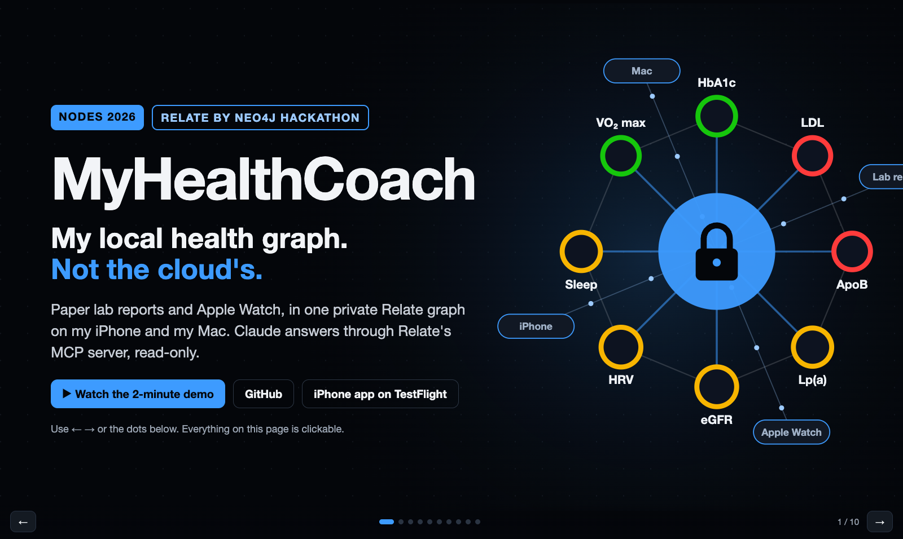
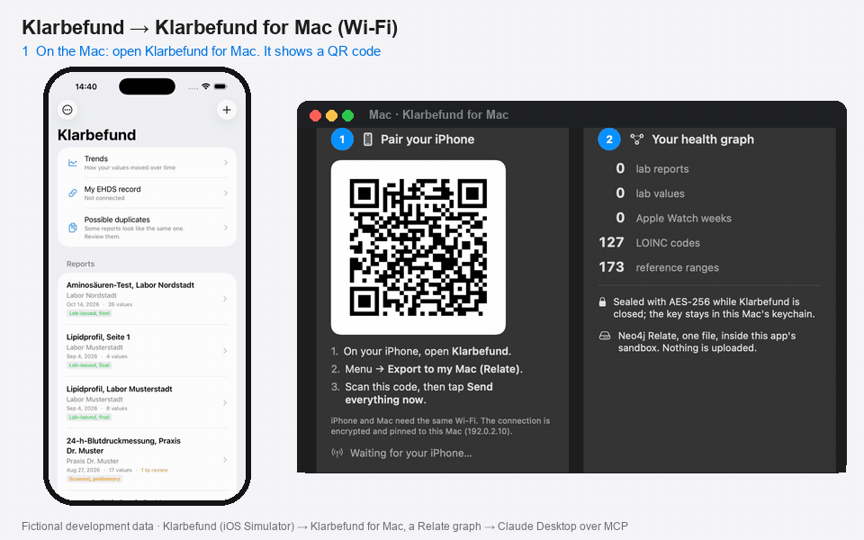

# MyHealthCoach: My Local Health Graph, Not the Cloud's

**My lab reports and Apple Watch, in one Neo4j Relate graph on my own iPhone and Mac. Encrypted, local, no cloud. Claude reads it read-only, through an MCP server on Relate.**

Our submission to the **[Relate by Neo4j Hackathon](https://relate.devpost.com/)** (NODES 2026).

| | |
|---|---|
| 🎬 **Demo video (2 min)** | [youtu.be/TZWaN4sBj1s](https://www.youtube.com/watch?v=TZWaN4sBj1s) · full 3-minute version: [youtu.be/HRmlXPt0r_k](https://www.youtube.com/watch?v=HRmlXPt0r_k) |
| 🌐 **Website** | [klarbefund.mabu.red](https://klarbefund.mabu.red/) (English) and [klarbefund.mabu.red/de/](https://klarbefund.mabu.red/de/) (Deutsch): Klarbefund for iPhone and Mac explained, with the TestFlight link |
| 🧊 **Live 3D demo** | [klarbefund.mabu.red/3d/](https://klarbefund.mabu.red/3d/): the 3D view of the Mac app on the synthetic sample graph, in the browser. Rebuild with `scripts/build_site_demo.py` |
| 🖥️ **Interactive presentation** | [klarbefund.mabu.red/slides.html](https://klarbefund.mabu.red/slides.html) |
| 🏆 **Devpost** | [MyHealthCoach on Devpost](https://devpost.com/software/myhealthcoach-my-local-health-graph-not-the-cloud-s) |
| 📱💻 **iPhone and Mac apps (TestFlight)** | [testflight.apple.com/join/ssADSXX6](https://testflight.apple.com/join/ssADSXX6): one link for Klarbefund on iPhone and [Klarbefund for Mac](docs/MAC.md) (pair, seal, connect Claude with one click, no scripts). Both are in development and testing, so TestFlight only, not on the App Store |
| 🔬 **For research** | [Klarbefund's graph in a Trusted Research Environment](#for-research-klarbefund-in-a-trusted-research-environment): why the analysis goes to the data, and how |
| 🧪 **Sample graph** | [`examples/health-graph/health.rl`](examples/health-graph/health.rl), synthetic, no real person |

[](https://klarbefund.mabu.red/slides.html)

## What it does

Klarbefund (iPhone) scans paper lab reports and codes every value with LOINC, with the page and line it came from. Relate, Neo4j's embedded graph database, turns them and the Apple Watch weekly means into one health graph: on the phone, and on the Mac inside an AES-256 encrypted vault. The graph also holds official and optimal reference ranges, six health risks, six published risk scores (SCORE2, eGFR, FIB-4, TyG, the triglyceride/HDL ratio and the urine albumin/creatinine ratio) with the exact values they used, how the risks raise each other (ten links from 13 meta-analyses, cohort pools and guidelines, each with its effect size and DOI), and the guideline sources. Claude Desktop asks it questions through Relate's MCP server, read-only, and turns it into a six-minute briefing before a doctor's visit.

Story: [docs/DEVPOST.md](docs/DEVPOST.md) · how it works: [docs/KLARBEFUND.md](docs/KLARBEFUND.md), [docs/SWIFT.md](docs/SWIFT.md), [docs/SCHEMA.md](docs/SCHEMA.md) · in plain words: [docs/EXPLAINED.md](docs/EXPLAINED.md)



### How it uses Relate

**Single-file mode.** Each person's whole health graph is one `.rl` file, so it can be encrypted as one unit to protect the personal data: on the iPhone, Klarbefund keeps it in the app's sandbox (`Application Support/HealthGraph`) under iOS Data Protection (`FileProtectionType.complete`, excluded from backup); on the Mac, Klarbefund for Mac keeps `health.rl` in its sandbox and seals it with AES-256-GCM whenever the app is closed, with the key in the Mac's keychain (the command-line route uses an AES-256 encrypted disk image, `~/RelateHealth`, instead). Relate itself does not encrypt the file; where it lives does. One file is also easy to back up encrypted, to delete for good, and to copy as a snapshot; the same Swift library (`HealthGraph`, on `RelateFFI.xcframework`) writes it on both devices, and Claude reads a read-only snapshot copy: through the Klarbefund extension while the Mac app is open, or through `relate serve --mcp --read-only`.

### Try it with the sample graph

[`examples/health-graph/health.rl`](examples/health-graph/health.rl) is a single-file Relate store built from the synthetic fixtures in this repo (no real person): 3 lab reports, 16 Apple Health weekly means, and the knowledge layer (173 reference ranges, 6 health risks, 6 risk scores, 55 marker links, 13 studies behind 10 links between the risks).

```bash
relate query --database examples/health-graph/health.rl --mode table <<< \
  "MATCH (h:HealthRisk)<-[:MARKER_OF]-(:LoincCode)<-[:CODED_BY]-(o:Observation) RETURN h.name AS risk, count(o) AS values"
python -m health_graph query --db examples/health-graph/health.rl trend --param loinc=4548-4
python -m health_graph query --db examples/health-graph/health.rl ranges --param loinc=22748-8
relate serve --mcp stdio --database examples/health-graph/health.rl --read-only   # for Claude Desktop or Claude Code
```

**See it in 3D.** In Klarbefund for Mac it is one click: *Open 3D view* in step 2 (build 9; the score cards and the prefill from lab values still come only with the terminal view). [`scripts/graph3d.py`](scripts/graph3d.py) turns a store into one interactive WebGL page ([3d-force-graph](https://github.com/vasturiano/3d-force-graph)). It opens on the health risks the knowledge layer tracks (conditions, the same for everyone, not diagnoses), ranked by your own newest values: your main risk large and red, the others dimmer, and a personal overview on the right with the published scores, the lipid markers beyond LDL (ApoB, non-HDL, triglyceride/HDL ratio, atherogenic index, remnant cholesterol), the older sources behind your values read critically, and the anamnesis protocols for what the graph cannot know (Life's Essential 8, FINDRISC, AUDIT-C, MEDAS-14, PHQ-2, tobacco, family history, lipid-lowering medication, eating pattern, and for a vegetarian or vegan answer a plant-based follow-up with your B12, folate and ferritin values), ranked by your findings and prefilled from your values, each answer coded with SNOMED CT; served from the vault, *Save to my graph* stores them. Time runs into the depth: older values sit further back, smaller and fainter, and count half after a year. Around the risks: risk scores, their marker codes and the latest value on each, plus orange arrows for how one risk raises another (fatty liver → diabetes, CKD and heart disease; diabetes → heart, kidneys, liver and bones; CKD → heart and bones), each with the study's effect size and a DOI. Then it adds the measures, the documents, and finally everything, with search and label filters. Click a risk to drill down: its scores, marker codes, every value on them by date, and the guideline ranges, with a sparkline per marker. A marker gets a time-series chart: real calendar spacing, the guideline range as a band, out-of-range values in red, one shape per lab, and Apple Watch weekly means under a four-week average. Click on to a single value, then to its report and the scanned document. The camera first flies to what you clicked, and its chain grows out of it. Something whose own view would hold fewer than 30 nodes (a single code, one Apple Watch week) opens no view of its own: it is picked out where it is and its details open on the right. A bar at the bottom shows each perspective you passed as a thumbnail; clicking one, or pressing Esc, restores that exact view. Every screen says in one line what you see. Step 2, *Evidence*, clusters the 49 studies and guidelines by topic and draws which cite each other (OpenAlex); the left panel lists them by topic. Step 3, *Anamnesis*, shows the protocols as their own category, with their LOINC and SNOMED CT codes. Many values sit on a **time spiral**: one turn per year, the oldest at the bottom, one small cluster per day.

```bash
python3 scripts/graph3d.py --db examples/health-graph/health.rl --out /tmp/graph3d/index.html
python3 -m http.server -d /tmp/graph3d --bind 127.0.0.1 8799   # then open http://127.0.0.1:8799
scripts/health_vault.sh graph3d   # your own graph: built and served inside the encrypted vault
```

Rebuild it: `python -m health_graph import --db health.rl fixtures/fhir/*.json`, then `python -m health_graph knowledge --db health.rl`. Setup: [docs/INSTALL.md](docs/INSTALL.md).

### Run it with your own data

The project runs on **your own devices**, with your own (or synthetic) health data that never leaves your home:

| You need | Why | Notes |
|---|---|---|
| 📱 **iPhone** (iOS 26) | Runs **Klarbefund**, which scans lab reports and reads Apple Health | Get it via **[TestFlight: testflight.apple.com/join/ssADSXX6](https://testflight.apple.com/join/ssADSXX6)** (QR code below). Build 15: "Export to my Mac" pairs with Klarbefund for Mac |
| ⌚ **A wearable**: Apple Watch, **Oura Ring**, Garmin, Withings, Whoop, a smart scale … | Pulse, HRV, sleep and sleep stages, VO2 max, SpO₂, steps, weight | Anything that syncs into **Apple Health** works, since Klarbefund reads from Apple Health. Sleep stages and VO2 max need a device that records them (Apple Watch, Oura, Garmin …) |
| 💻 **Mac** (macOS 14 or later) | Runs **Klarbefund for Mac**: the **Relate** graph (Neo4j's embedded graph DB), the receiver the phone pairs with by QR code, the one-click connection to Claude Desktop, and the setup for ChatGPT, Gemini CLI or a local model in LM Studio | **No scripts:** install it from the same [TestFlight link](https://testflight.apple.com/join/ssADSXX6), see [docs/MAC.md](docs/MAC.md). Developers can still use the command-line receiver and the encrypted vault: [docs/INSTALL.md](docs/INSTALL.md) |
| 📶 The **same Wi-Fi**, or a **USB cable** | The phone sends data straight to your Mac, encrypted, no cloud | Pinned TLS over Wi-Fi; no shared network (guest Wi-Fi, client isolation) → USB cable |
| 📄 *Optional:* a few **paper lab reports** | Real-world test material for the scanner | Your data stays on your devices; nothing goes into this repo |

 *Scan with the iPhone camera to join the Klarbefund beta on TestFlight; open the same link on the Mac for Klarbefund for Mac.*

No iPhone? The sample graph above runs anywhere Relate runs, and Klarbefund has a demo mode with fictional data in the iOS Simulator (Mac with Xcode).


**Claude skill.** The personal anamnesis is also a Claude skill, the method without any data: [`plugins/klarbefund`](plugins/klarbefund). In Claude Code: `/plugin install klarbefund --marketplace ma3u/relate-hackathon-team`. In Claude Desktop: Klarbefund for Mac saves it as a zip (step 3, *Add the Klarbefund skill to Claude*) for Customize → Skills → Upload. See [docs/MCP.md](docs/MCP.md#the-klarbefund-skill-and-assessments).

**Answers in both places.** Claude Desktop stores anamnesis answers in Klarbefund for Mac; Claude Code and the scripts store them in the vault. `scripts/health_vault.sh sync` (or `python -m health_graph sync --db …`) brings each side what the other has, through the app's own MCP helper, the one program allowed to read the app's graph. It only adds: a response keeps its time and source, a second run moves nothing, and a response edited on one side since is reported, not copied. The anamnesis plan also lists the tests to ask the doctor for (a coronary calcium score while a lipid decision is open, cystatin C when creatinine may mislead, Lp(a) for relatives), each only until its value is in the graph.

## For research: Klarbefund in a Trusted Research Environment

**Yes, Klarbefund's graph can run in a researcher's remote desktop.** The part that runs there is the graph, not the apps: the Relate store, the `health_graph` package (import, knowledge layer, risk scores, anamnesis rules), the 3D view and the read-only MCP server. The iPhone and Mac apps stay with the person they belong to.

### Why

MyHealthCoach is **primary use**: one person, their own data, on their own devices. Research on many people's graphs is **secondary use**, and there the rule turns around. The data must not travel to the researcher, so the researcher's analysis travels to the data. Under the European Health Data Space this happens in a **secure processing environment** ([Regulation (EU) 2025/327, Art. 73](https://eur-lex.europa.eu/eli/reg/2025/327/oj/eng#art_73)), which research infrastructure calls a **Trusted Research Environment** (TRE). For an operating example, see QCIF's [KeyPoint](https://www.qcif.edu.au/products/keypoint) in Australia, ISO/IEC 27001 certified since February 2026. KeyPoint gives each project a ring-fenced "Vault" with remote desktops, and a data steward approves every file that goes in or out.

The idea is the same as on the iPhone, one level up: on the phone, *my graph, not the cloud's*; in the TRE, *the data stays where it is, the analysis comes to it*.

### How

A TRE is usually judged by the **Five Safes**. Here is how each one is met, in this repo and in the EHDS reference hub ([MinimumViableHealthDataspacev2](https://github.com/ma3u/MinimumViableHealthDataspacev2)) that Klarbefund came from:

| Safe | What it means | How | Status |
|---|---|---|---|
| **Safe projects** | Only an approved purpose | The health data access body issues a permit for one purpose and named datasets | Built in the hub |
| **Safe people** | Only named, verified researchers | The permit names each person, who signs in with a second factor | Planned ([#1030](https://github.com/ma3u/MinimumViableHealthDataspacev2/issues/1030)) |
| **Safe settings** | A workspace nobody else can look into, not even the operator | A confidential container (AMD SEV-SNP). The data key is released only to hardware that proves it runs exactly the tools the permit names. No internet; one workspace per permit | Two attested workspaces built; per-permit workspace with a remote desktop planned ([#1132](https://github.com/ma3u/MinimumViableHealthDataspacev2/issues/1132)) |
| **Safe data** | Only what the purpose needs, pseudonymised | The permit's datasets only, research pseudonyms, persons who opted out removed. Relate's one file per person fits this: each pseudonymised person is one `.rl` file | Partly built |
| **Safe outputs** | Only results that can't identify anyone | Groups under five suppressed automatically (built). An airlock where the access body reviews every file before it leaves, with each file's SHA-256 on the audit chain | Airlock planned ([#1133](https://github.com/ma3u/MinimumViableHealthDataspacev2/issues/1133)) |

**The path:**
1. The person shares their Klarbefund data with the hub, or doesn't opt out of research use (Art. 71).
2. A researcher applies, and the access body issues a permit.
3. The permit's extract is pseudonymised and sealed, and opens only inside the attested workspace.
4. In the researcher's remote desktop, the same code as on the Mac builds one Relate graph per person and adds the knowledge layer: reference ranges, risks, risk scores, the study evidence. The anamnesis rules then answer cohort questions, such as how many people have an LDL above the guideline target and no lipid-lowering medication.
5. Results leave only through the airlock.

**What runs where**

| Component | Person's iPhone / Mac | Researcher's remote desktop (Linux, in the TRE) |
|---|---|---|
| Klarbefund on iPhone, Klarbefund for Mac | ✅ | – (iOS and macOS apps, and they hold one person's own data) |
| Relate store and `relate` CLI | ✅ | ✅ Relate ships Linux builds (CLI, Python wheels, FFI) |
| `health_graph`: import, knowledge, scores, anamnesis plan | ✅ | ✅ |
| 3D view (`scripts/graph3d.py`) | ✅ | ✅ served inside the workspace |
| `relate serve --mcp --read-only` | ✅ | ✅ |
| Claude | Claude Desktop on the Mac | Only with a model endpoint the access body approves, since a TRE has no internet. Everything sent to the model counts as processing under the permit. Not decided |

**Checked on Linux (2026-11-16).** In a `python:3.12-slim` container (Linux, ARM64) with Relate 1.0.1's Linux binary and the `relate-db` wheel, using the synthetic sample graph:
- All 67 tests pass.
- The anamnesis plan runs.
- The 3D view builds (582 nodes, 974 relationships).
- The read-only MCP server answers.

```bash
docker run --rm -it -v "$PWD":/w:ro -w /w python:3.12-slim bash
pip install relate-db segno pytest   # then put relate-linux-arm64 (or -amd64) from github.com/relatedb/relate/releases on the PATH
python -m pytest -q tests
python -m health_graph anamnesis --plan --db examples/health-graph/health.rl
```

**Open:**
- Per-permit workspaces and the airlock are plans, not code ([#716](https://github.com/ma3u/MinimumViableHealthDataspacev2/issues/716)).
- `health_graph`'s command line expects one person per store, so a cohort runner over many `.rl` files is still to write.
- Today the hub leaves Klarbefund data out of research extracts; sharing it for research needs the person's decision in the app first.

## Built with, and what was built during the hackathon

**Relate capabilities used:** the embedded engine in Swift on iOS and macOS (through `RelateFFI.xcframework`, our `HealthGraph` Swift package), the Python library (`relate-db`, the reference implementation in `health_graph/`), the `relate` CLI, single-file `.rl` stores, and `relate serve --mcp --read-only` for Claude.

**Third-party tools:** FHIR R4, LOINC, NCBI Taxonomy and the OMOP CDM as data models; swift-nio with Apple's Network framework for the pinned-TLS receiver in the Mac app (swift-nio-ssl only in the command-line receiver); 3d-force-graph (Three.js) for the 3D view; ffmpeg, Playwright and headless Chrome for the video; ElevenLabs for the narration in my own cloned voice.

**AI tools (disclosed as the rules ask):** the code, docs and video were written with Claude Code (Anthropic); Claude Desktop is the assistant that queries the graph in the demo.

**Started during the hackathon (from Nov 11, 2026):** this repository: the health graph model and importer, the knowledge layer, the risk scores, the Swift library and Mac receiver, the iPhone graph and the Mac export in Klarbefund, the dashboard, the video and this presentation. **Reused, existing before:** the Klarbefund iPhone app itself (lab report scanning and LOINC coding, started March 2026, [MinimumViableHealthDataspacev2](https://github.com/ma3u/MinimumViableHealthDataspacev2)) and its reference-range table. Only the Relate integration is new.

## About Relate

Relate is an **open-source, embedded graph database for AI agents** and the engineers who build them. It runs as a library inside your app — no signup, no server.

- **Install and go** — one command adds a Relate skill to your coding agent
- **Query in process** — traverse relationships and run vector search without network calls
- **Agent-ready results** — JSON output with row limits and errors that explain how to fix them
- **Safe shared state** — transactions so multiple agents can update the same graph
- **Lightweight** — one file per graph, memory limits, delete when done
- **Connect when needed** — pull a subgraph from Neo4j, query with Cypher over MCP, Bolt, or HTTP
- **Runs in the browser** — WebAssembly build for interactive graph views
- Use it from the **CLI**, as a **Rust** or **Python** library, or via **WASM**

### Resources

- 🛠️ **Our setup guide, with screenshots: [docs/INSTALL.md](docs/INSTALL.md)** (Relate CLI, agent skill, Python, MCP, ElevenLabs)
- 📱 **Klarbefund + Apple Health → local Relate → Claude: [docs/KLARBEFUND.md](docs/KLARBEFUND.md)**
- 🔌 **The Klarbefund MCP server (tools, 24 prompts, guides, protocol revisions, security, why no OAuth): [docs/MCP.md](docs/MCP.md)**
- 🍎 **Swift on iPhone and Mac, the graph on the phone itself: [docs/SWIFT.md](docs/SWIFT.md)**
- 🌐 Website: <https://relatedb.ai>
- ⚡ Quickstart / install: <https://relatedb.ai/docs/get-started/install>
- 💻 Source: <https://github.com/relatedb/relate>
- 💡 Idea list: <https://github.com/jexp/relate-ideas>
- 🏆 Devpost: <https://relate.devpost.com/> · [Rules](https://relate.devpost.com/rules) · [Schedule](https://relate.devpost.com/details/dates)

## License

Apache License 2.0, see [LICENSE](LICENSE). Code systems keep their own terms: LOINC (Regenstrief), UCUM, SNOMED CT (affiliate licence).
