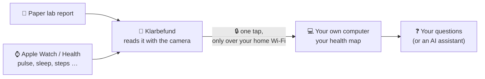
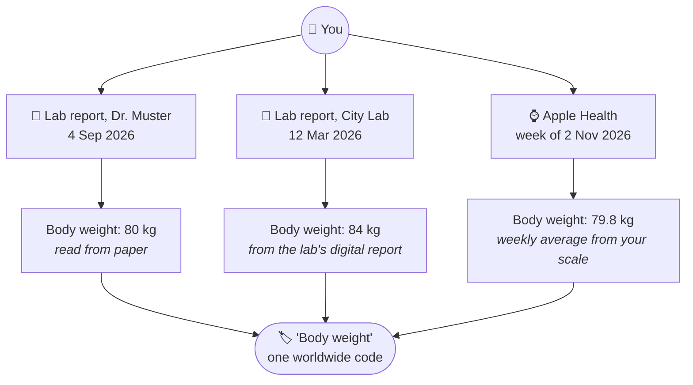
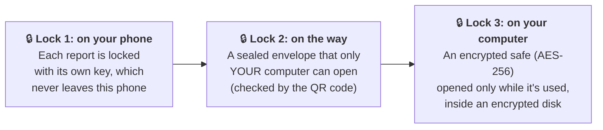

# Your health data, connected and kept at home: in plain words

*This page explains the [Sovereign Health Graph idea](IDEA.md) without technical or medical background. The examples use made-up values.*

## The problem in one minute

Your health information is scattered:
- **Paper lab reports** from your doctor or a lab, in a drawer or a photo on your phone.
- **Your phone and watch** count steps, measure your pulse and track your sleep, but in a separate app.
- Each lab writes things slightly differently: one says *"LDL-Cholesterin"*, another *"LDL cholesterol"*, a third uses a different unit.

So simple questions are surprisingly hard to answer:
*"How has my cholesterol changed over the last three years?"*
*"Did my resting pulse go down in the months my blood values got better?"*

And most apps that *could* answer them want you to upload everything to their cloud.

## What we built

1. **Klarbefund** (an iPhone app) reads your paper lab reports with the camera and turns them into clean, labelled values.
2. With one tap it sends those values, plus weekly summaries from Apple Health, **to your own computer at home**, not to the internet.
3. On your computer they land in a **connected "map" of your health data**. You can ask it questions, or let an AI assistant ask them for you.
4. **No computer? The same map can live on the phone itself.** Switch on *Health graph on this iPhone* and Klarbefund builds it right there, locked whenever the phone is locked, and never backed up or sent anywhere.

## Why a "map" and not a spreadsheet?

Think of a **mind map**, or a family tree. Every value is a card, and cards are connected by lines:

- Each value is connected to **the report it came from** (which lab, which day).
- Each value is connected to **what was measured**, using a worldwide code.
- So the same kind of measurement **lines up automatically**, no matter who measured it.

The three weight values come from three different places, but they all point to the same label, so they show up together in one timeline. The same happens for resting pulse (from an ECG at the doctor's and from your watch) and for fitness: a professional treadmill test and your watch's estimate.

### The "worldwide code" (LOINC)

Labs all over the world use **LOINC codes**, like a **barcode for each kind of test**. Whether the paper says *"Körpergewicht"*, *"body weight"* or *"Gewicht"*, the code is the same. That's what lets the map connect things across labs, languages and devices.

### "Where did this value come from?"

Every value keeps a label telling you how much to trust it:

| Label | Means | How much to trust it |
|---|---|---|
| 🧾 **From the lab's digital report** | The lab sent it digitally | As the lab printed it |
| 📷 **Read from paper** | The camera read it (OCR) | Check it against the paper; you can correct it in the app |
| ✍️ **Typed in by you** | You entered it | As you typed it |
| ⌚ **Weekly average from a device** | Your watch / phone over one week | A trend, not a medical measurement |

If the app **couldn't recognise** a value (a rare test, an unusual unit), it still keeps it, clearly marked as *"not recognised"* with the reason. It never guesses.

## Is my data safe?

Think of three locks:

- **On the phone:** every report is encrypted on its own. The key stays on that phone: it's not in iCloud, not in backups, and doesn't move to a new phone.
- **On the way:** the phone talks only to *your* computer on *your* home network. Scanning the QR code once teaches the phone your computer's "fingerprint". A stranger's computer on the same Wi-Fi can't pretend to be yours. And everything travels encrypted, like HTTPS on a banking website.
- **On your computer:** the data sits in an **encrypted safe**: a locked container (AES-256) that is opened only while the phone sends data or you ask questions, and locked again afterwards. Its key is kept in your Mac's Keychain. On top of that, your whole disk is encrypted (FileVault). While the safe is locked, the folder is simply empty.
- **Nothing goes to a cloud** on the way from phone to computer.

**One honest caveat:** if you ask an online AI assistant (such as Claude) about your data, the answer it needs, for example your cholesterol values, is sent to that assistant over an encrypted connection. Ask general questions ("how many reports do I have?"), or use an AI that runs on your own computer, if nothing at all may leave your home.

## What it does *not* do

- It does **not** diagnose anything, and it never says "normal" or "abnormal". It shows the reference range **exactly as the lab printed it**.
- It is **not** medical advice. Questions about your values belong with your doctor.
- It does **not** share anything with anyone unless you switch it on.

## Example questions you could ask

- *"Show my cholesterol values over time, and which ones were read from paper."*
- *"How did my average sleep change in the weeks around my last blood test?"*
- *"Which values could the app not recognise, and why?"*
- *"Compare my watch's fitness estimate (VO2 max) with the result of my treadmill test."*

---

## Health words, briefly

*Definitions only, not advice. Your lab's printed range and your doctor are what count.*

| Word | What it is |
|---|---|
| **Lab report** | A sheet from a laboratory listing measured blood (or urine) values with the lab's reference ranges |
| **Reference range** | The range the lab prints next to a value for comparison, e.g. "4.0–6.0". It differs between labs |
| **HbA1c** | A blood value reflecting average blood sugar over roughly the last 2–3 months |
| **LDL cholesterol** | One type of blood fat measured in a standard lipid panel |
| **Ferritin** | A blood value related to the body's iron stores |
| **CRP** | A blood value often measured to look for inflammation |
| **Resting heart rate** | Your pulse when you're at rest, in beats per minute |
| **HRV (heart rate variability)** | How much the time between heartbeats varies; watches report it in milliseconds |
| **VO2 max / cardio fitness** | How much oxygen your body can use during hard exercise; a measure of fitness. A watch *estimates* it; a treadmill test with a mask *measures* it |
| **Blood oxygen (SpO₂)** | The share of oxygen-carrying red blood cells, in %, measured with light through the skin |
| **Respiratory rate** | Breaths per minute, usually measured during sleep by the watch |
| **Sleep stages** | Deep, REM and light ("core") sleep, which watches estimate from movement and heart rate |
| **Body fat %** | The share of body weight that is fat, from smart scales or special scans (DXA) |
| **Microbiome** | The bacteria in your gut; some stool tests list them by name |

## Tech words, briefly

| Word | In plain words |
|---|---|
| **Graph database** | A database that stores *things and how they connect*, like a mind map, instead of rows in a table |
| **Relate** | Neo4j's new graph database that runs as a single file on your own computer: no server, no account |
| **Klarbefund** | The iPhone app that reads lab reports and keeps them encrypted on the phone |
| **LOINC** | The worldwide "barcode" system for lab tests and measurements |
| **FHIR** | A common format hospitals and apps use to exchange health data, so systems understand each other |
| **OMOP** | A format researchers use to analyse health data from many sources the same way |
| **EHDS** | The European Health Data Space: EU rules giving people more control over their health data |
| **QR pairing** | Scanning a code once so the phone knows which computer is yours and how to recognise it |
| **Encryption** | Scrambling data so only someone with the right key can read it |
| **MCP** | A standard way for AI assistants to look things up in your tools, here your health map, read-only |

*For the technical version, see [IDEA.md](IDEA.md), [SCHEMA.md](SCHEMA.md) and [KLARBEFUND.md](KLARBEFUND.md).*
