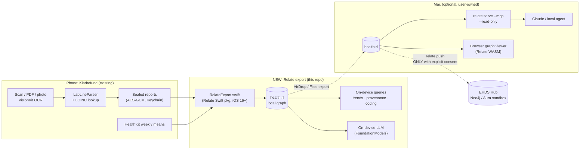
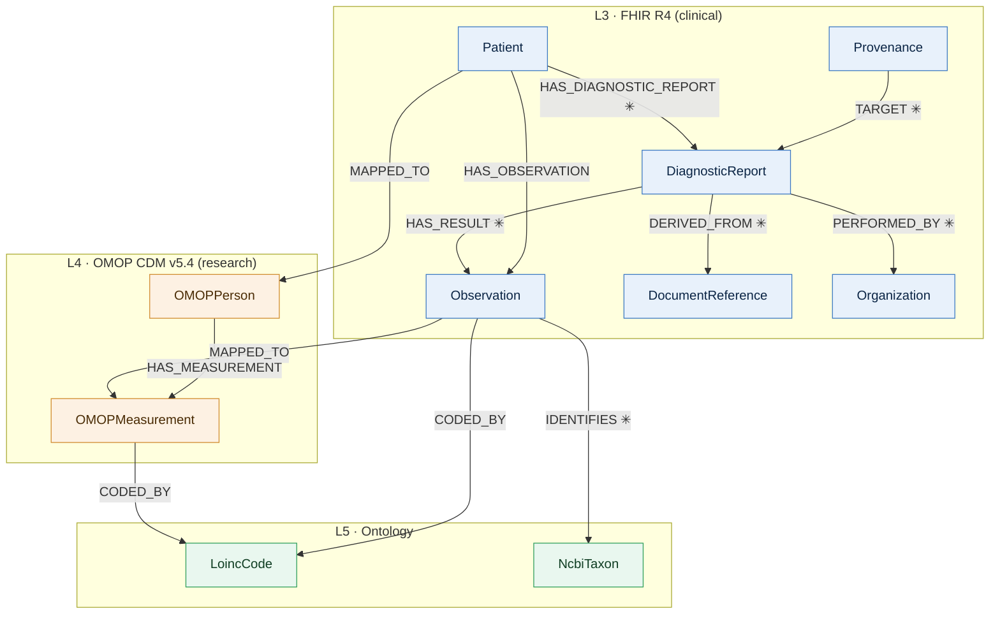
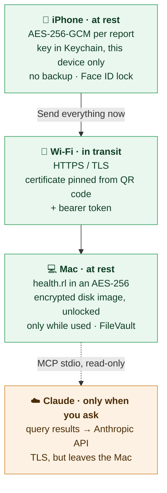

# Idea: Sovereign Health Graph: Klarbefund × Relate

> **Your lab results, as a connected graph that never leaves your device.**
> Klarbefund turns paper lab reports into structured, LOINC-coded values. This feature exports them into a **local Relate graph** (one `.rl` file) using the same **FHIR R4 → OMOP CDM → ontology** model as the [EHDS Integration Hub](https://ma3u.github.io/MinimumViableHealthDataspacev2/docs). The patient (or their own local agent) can then explore connected health context privately, and **push to the Hub only with explicit consent**.

> 👋 **New here, or not a developer or health professional?** Start with the plain-language version: **[Your health data, connected and kept at home](EXPLAINED.md)**.

Status: draft, Nov 11, 2026 · Owner: [@ma3u](https://github.com/ma3u) · Feedback welcome in [issues](../../../issues)

---

## Why this fits "Context, Connected"

| Judging criterion | How we hit it |
|---|---|
| **Creativity** | An *embedded* graph DB on a phone as a **personal health data space**: the EHDS idea of "primary use stays with the citizen", made real on-device |
| **Usefulness** | Lab values are only meaningful in context: trends over time, which values belong to which report and lab, how a value is coded (LOINC/SNOMED), and wearable weekly means alongside. Today that context only exists on a server |
| **Completeness** | A runnable path end to end: scan or import a report → local `.rl` → query (app, CLI, MCP) → optional consented push |
| **Clarity** | A 3-minute demo with a graph view (WASM) and an ElevenLabs voice-over |
| **Effective use of connected context** | Relate's Swift embedding, Cypher MERGE upserts, hybrid (vector + full-text) search over analyte names, MCP for a local agent, and `relate push` for the consented hop to Neo4j/Aura |

## What exists already (disclosed reuse)

The hackathon rules say **new projects only, started on or after Nov 11, 2026**. Reusing earlier code is allowed if disclosed, and only contest-period work is judged. So:

- **Pre-existing (disclosed, not judged):** the Klarbefund iOS app (`clients/ios/` in [MinimumViableHealthDataspacev2](https://github.com/ma3u/MinimumViableHealthDataspacev2)): VisionKit OCR, `LabLineParser`, LOINC lookup (1760 codings), `FhirBundle.swift`, `OmopExport.swift`, sealed on-device storage, consent ledger, and the EHDS Hub with its 5-layer Neo4j graph.
- **New in this hackathon (judged):** the Relate export module, the local graph schema and transforms, local query and agent tooling, the browser graph viewer, and the consented push. All of it lives in **this** repo.

## Architecture



## Meta model of the local Relate graph (as built)

Read from the live store `~/RelateHealth/health.rl` (structure only): **10 node labels, 12 relationship types**, in three of the EHDS layers. Keys and Observation properties follow the EHDS Hub's *code* (`storeReportRows`, `app-wearables.ts`), so a `relate push` merges cleanly. Relationship types marked ✳ are new in this project.



| Label | Layer | Key | Main properties |
|---|---|---|---|
| `Patient` | L3 | `id` | (no name, no birth date) |
| `DiagnosticReport` | L3 | `resourceId` | `reportId`, `effectiveDate`, `status`, `performer`, `title` |
| `Observation` | L3 | `resourceId` | `code`, `display`, `valueQuantity`, `unit`, `comparator`, `referenceLow/High/Text`, `effectiveDate` (`effectiveStart` for weekly means), `category`, `status`, `sourceKind`, `sourceLine`, `sourceReport`, `unmappedReason`, `hubEligible` |
| `DocumentReference` | L3 | `resourceId` | `title`, `created` |
| `Provenance` | L3 | `resourceId` | `activity`, `agent`, `recorded` |
| `Organization` | L3 | `name` | the lab or practice |
| `OMOPPerson` | L4 | `id` | `genderConceptId` |
| `OMOPMeasurement` | L4 | `id` | `measurementDate`, `valueAsNumber`, `unitSourceValue`, `measurementSourceValue` (= LOINC), `measurementConceptId = 0` (no Athena on the device) |
| `LoincCode` | L5 | `code` | `display` |
| `NcbiTaxon` | L5 | `code` | `display` (microbiome organisms) |

**One `Observation` label, four kinds of value.** `sourceKind` says where it came from, so a lab value, an OCR reading and a watch's weekly mean live side by side and never get mixed up:

| `sourceKind` | From | `sourceReport` | Example `code` |
|---|---|---|---|
| `lab-issued-digital` | a lab's digital report (status `final`) | report UUID | 2089-1 LDL cholesterol |
| `ocr-transcribed` | a scanned / photographed paper (status `preliminary`) | report UUID | 4548-4 HbA1c |
| `self-tracked` | typed in by the person | report UUID | 29463-7 body weight |
| `device-weekly-mean` | Apple Health via Klarbefund, one per metric and week | `apple-health-weekly` | 40443-4 resting HR, 94122-9 VO2 max, 93832-4 sleep |

**Where the context connects.** The `LoincCode` node is the hub of the graph. Body weight from a lab sheet, a body-composition scale and Apple Health share **29463-7**. Resting heart rate from an ECG sheet and the watch share **40443-4**. The watch's VO2 max estimate and a spiroergometry's measured VO2 peak share **94122-9**. A value Klarbefund could not code has `code = null`, the printed label in `display`, and the reason in `unmappedReason`; a microbiome organism has no LOINC term and is linked to `NcbiTaxon` instead.

Rules carried over from Klarbefund:
- **Provenance survives**: `sourceKind`, `sourceLine` (the printed line), OCR confidence, patient verification and corrections (`originalReading`) stay on the value; OCR values are never `final`.
- **No fake codes**: an unmapped value keeps `code = null` and its reason; nothing is guessed.
- **No verdicts**: ranges are stored as printed (`referenceText`), never as normal/abnormal (not a medical device; MDCG 2019-11).
- **No names**: `Patient` has an id only; `OMOPPerson` carries no name (Hub #475).

### Example queries (run against the live graph)

```cypher
// One analyte across lab reports and devices, with where each value came from
MATCH (:Patient)-[:HAS_OBSERVATION]->(o:Observation)-[:CODED_BY]->(:LoincCode {code: $loinc})
OPTIONAL MATCH (dr:DiagnosticReport)-[:HAS_RESULT]->(o)
RETURN left(o.effectiveDate, 10) AS date, o.valueQuantity AS value, o.unit AS unit,
       o.sourceKind AS source, coalesce(dr.performer, o.performer) AS lab_or_device
ORDER BY date;

// Which values could NOT be coded, and why (honesty about data quality)
MATCH (o:Observation) WHERE o.code IS NULL
OPTIONAL MATCH (o)-[:IDENTIFIES]->(t:NcbiTaxon)
RETURN o.display, o.unmappedReason, t.code AS ncbiTaxon, count(*) ORDER BY count(*) DESC;
```

Full-text search over printed labels, source lines and LOINC names is built in (`weight` finds *Körpergewicht*); vector search over LOINC names is next.

## Encryption at rest and in transit



| Where | Protected by | Detail |
|---|---|---|
| **iPhone, at rest** | ✅ App-level encryption | Each report, its scan and its diagnostics are sealed **individually** with **AES-256-GCM** (CryptoKit). The key is created on the device and kept in the Keychain as `kSecAttrAccessibleWhenUnlockedThisDeviceOnly`: unavailable while the phone is locked, never synced to iCloud Keychain, never restored onto another device. Files use `FileProtectionType.complete` and are **excluded from backup**. The Mac pairing (address, token, certificate pin) is in the Keychain too. The current build adds an optional Face ID / passcode app lock. |
| **iPhone → Mac, in transit** | ✅ TLS with certificate pinning | The receiver presents an X.509 v3 certificate with a P-256 key. The app accepts **only** the certificate whose SHA-256 fingerprint was in the QR code, so even a TLS-capable impostor on the same Wi-Fi gets nothing. `http://` links are refused, as are hosts outside private, loopback and `.local` ranges. Every request carries a 256-bit bearer token. The receiver only accepts data and returns a count, so nothing can be *read* from it. |
| **Mac, at rest** | ✅ Sealed file or encrypted disk image + FileVault | Relate itself stores the graph unencrypted. **Klarbefund for Mac** keeps `health.rl` in its sandbox and seals it with AES-256-GCM whenever the app is closed, the key in the Mac's keychain ([MAC.md](MAC.md)). On the command-line route, `health.rl` lives inside an **AES-256 encrypted APFS disk image** (`~/RelateHealthVault.sparsebundle`), mounted at `~/RelateHealth` only while the receiver or Claude needs it ([`scripts/health_vault.sh`](../scripts/health_vault.sh)). Its password is a random 256-bit secret in the macOS login Keychain. While locked, `~/RelateHealth` is empty, and the receiver refuses to start (`--require-mount`), so it can never write a new plaintext store. FileVault encrypts the whole disk underneath. Verified: the image's bytes contain none of the 251 readable health strings the plain file had. |
| **Mac → Claude** | ⚠️ TLS, but leaves the Mac | MCP runs locally over stdio, read-only. Claude Desktop/Code then send the **rows a query returns** to Anthropic's API over TLS. Ask aggregate questions, or use a local model, if nothing may leave the Mac. |
| **Mac → EHDS Hub** | (planned) | Only via an explicit, consented `relate push`, audited as a `TransferEvent`. Not built yet. |

## Demo storyline (≤ 3 min, ElevenLabs narration)

1. **0:00–0:20 Problem.** A paper lab report. Your data is "yours" under EHDS, but the context lives on servers.
2. **0:20–1:00 Scan.** Klarbefund scans the report → values with LOINC codes and provenance.
3. **1:00–1:40 Local graph.** "Export to my graph" → `health.rl` on the phone; an on-device trend query; airplane mode on to show nothing leaves the device.
4. **1:40–2:20 Agent.** On the Mac: `relate serve --mcp --read-only health.rl` → ask Claude "how did my HbA1c develop and which values are OCR-only?", with the answer citing nodes. Browser WASM view shows the connected graph.
5. **2:20–2:50 Consent.** Toggle consent → `relate push --dry-run` → push the subgraph into the EHDS sandbox; the Hub logs a `TransferEvent`.
6. **2:50–3:00 Close.** "Context, connected, and sovereign."

All demo data is **synthetic / fictional** (Synthea-style). No real health data anywhere in the repo.

## Plan (4 weeks)

| Week | Goal |
|---|---|
| **1 · Nov 11–17** ✅ | Schema + Cypher DDL · synthetic fixtures · Python proof FHIR Bundle → `health.rl` with 8 queries + OMOP transform, 15 tests, CI → **[SCHEMA.md](SCHEMA.md)** · *open: team formed* |
| **2 · Nov 18–24** ✅ started early | ✅ QR-paired export iPhone → Mac receiver → `health.rl` incl. Apple Health, Claude MCP ([KLARBEFUND.md](KLARBEFUND.md)) · ✅ **Swift**: HealthGraph library on Relate's Swift package, Swift Mac receiver/CLI, **on-device graph in Klarbefund** with Cypher queries on the phone ([SWIFT.md](SWIFT.md)) · open: on a real iPhone |
| **3 · Nov 25–Dec 1** | In-app "Export to my graph" and trend view · MCP + Claude flow on Mac · WASM graph viewer |
| **4 · Dec 2–11** | Consented `relate push` to the Hub sandbox · README/setup polish · demo video + voice-over · **submit by Dec 11 (CET evening)** |

**MVP** = weeks 1–2 plus the MCP demo. **Stretch** = in-app UI, WASM viewer, push.

## Roles (where teammates plug in)

| Role | Owns |
|---|---|
| @ma3u | Graph model, Klarbefund integration, EHDS Hub, MCP/agent flow |
| 🌐 **Frontend / WASM** | Browser graph viewer on Relate WASM (OPFS store, drag-and-drop `.rl`) |
| 🎬 **Design / storytelling** | Demo script, screen recording, ElevenLabs voice-over, Devpost page |
| 🧭 **Health domain (FHIR/OMOP)** | Mapping review, synthetic test data, "is this clinically sensible?" checks |
| 🦀/🍎 *(nice to have)* **Swift/Rust** | Relate Swift package integration, performance on device |

## Privacy and sovereignty guardrails

- Encryption at rest and in transit: see [Encryption at rest and in transit](#encryption-at-rest-and-in-transit). On the Mac the graph lives in an AES-256 encrypted disk image (decided Nov 11). Real health data never goes into this repository; docs show counts only.
- **New, separate consent** for "build a local graph". The Hub record that Klarbefund reads is currently promised to be "kept nowhere", so we **don't import it** into the local graph unless the user explicitly opts in with new wording.
- **A push is a transfer**: it needs registry consent from `ConsentLedger`, follows the Hub's `app/record` contract (preliminary, LOINC, UCUM, sandbox only), and is audited as a `TransferEvent` (EHDS Art. 73).
- The MCP server is opened **`--read-only`**, and any AI answer names its provider and model (AI Act Art. 50).

## Risks and open questions

- **Schema drift in the Hub.** Spec vs code: `id` vs `resourceId`, `code` vs `loincNumber`, `HAS_MEDICATION` vs `HAS_MEDICATION_REQUEST`, `CODED_BY` vs `STANDARD_CONCEPT`. → We pin to the **code** (`load_fhir_neo4j.py`, `storeReportRows`, `fhir-to-omop-transform.cypher`) and document it.
- **App Observations** use `valueQuantity` / `effectiveDate`, while the Hub transform reads `value` / `dateTime`. → Our local transform reads both, and we file a Hub fix.
- **No APOC/GDS in Relate.** The FHIR→OMOP transform is plain `MERGE`/`SET`/`CASE` and should port; FastRP embeddings are out (we use Relate's vector index instead).
- **Relate Swift on a real iPhone.** The package targets iOS 16+, Swift 6, with an `ios-arm64` XCFramework. We verify it in week 2 on device (Klarbefund is Swift 6, iOS 26).
- **Relate is brand new (v1.0.0)** and some features are marked experimental. We keep a CLI/Python fallback for the demo.

## References

- EHDS docs: <https://ma3u.github.io/MinimumViableHealthDataspacev2/docs> · Klarbefund: <https://ma3u.github.io/MinimumViableHealthDataspacev2/docs/klarbefund>
- Relate: [Swift package](https://relatedb.ai/docs/guides/embed/swift) · [Push to Neo4j](https://relatedb.ai/docs/guides/neo4j/push-to-neo4j) · [Hybrid search](https://relatedb.ai/docs/guides/cypher/full-text-and-hybrid-search) · [MCP](https://relatedb.ai/docs/guides/agents/connect-over-mcp) · [Ontology](https://relatedb.ai/docs/guides/cypher/ontology)
- Our setup guide: [INSTALL.md](INSTALL.md)
