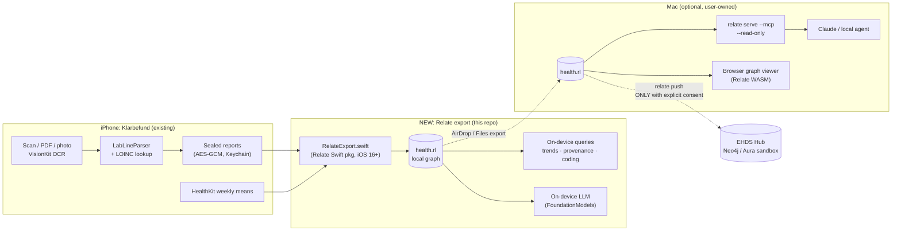

# Idea: Sovereign Health Graph: Klarbefund × Relate

> **Your lab results, as a connected graph that never leaves your device.**
> Klarbefund turns paper lab reports into structured, LOINC-coded values. This feature exports them into a **local Relate graph** (one `.rl` file) using the same **FHIR R4 → OMOP CDM → ontology** model as the [EHDS Integration Hub](https://ma3u.github.io/MinimumViableHealthDataspacev2/docs). The patient (or their own local agent) can then explore connected health context privately, and **push to the Hub only with explicit consent**.

Status: draft, Nov 11, 2026 · Owner: [@ma3u](https://github.com/ma3u) · Feedback welcome in [issues](../../../issues)

---

## Why this fits "Context, Connected"

| Judging criterion | How we hit it |
|---|---|
| **Creativity** | An *embedded* graph DB on a phone as a **personal health data space**: the EHDS idea of "primary use stays with the citizen", made real on-device |
| **Usefulness** | Lab values are only meaningful in context: trends over time, which values belong to which report and lab, how a value is coded (LOINC/SNOMED), and wearable weekly means alongside. Today that context only exists on a server |
| **Completeness** | A runnable path end to end: scan or import a report → local `.rl` → query (app, CLI, MCP) → optional consented push |
| **Clarity** | A 3-minute demo with a graph view (WASM) and an ElevenLabs voice-over |
| **Effective use of connected context** | Relate's Swift embedding, Cypher MERGE upserts, hybrid (vector + full-text) search over analyte names, MCP for a local agent, and `relate push` for the consented hop to Neo4j/Aura |

## What exists already (disclosed reuse)

The hackathon rules say **new projects only, started on or after Nov 11, 2026**. Reusing earlier code is allowed if disclosed, and only contest-period work is judged. So:

- **Pre-existing (disclosed, not judged):** the Klarbefund iOS app (`clients/ios/` in [MinimumViableHealthDataspacev2](https://github.com/ma3u/MinimumViableHealthDataspacev2)): VisionKit OCR, `LabLineParser`, LOINC lookup (1760 codings), `FhirBundle.swift`, `OmopExport.swift`, sealed on-device storage, consent ledger, and the EHDS Hub with its 5-layer Neo4j graph.
- **New in this hackathon (judged):** the Relate export module, the local graph schema and transforms, local query and agent tooling, the browser graph viewer, and the consented push. All of it lives in **this** repo.

## Architecture



## Local graph model (subset of the EHDS 5 layers)

For labels and keys shared with the Hub we use the **Hub's actual code-level schema** (not the spec, where the two drift; see Risks), so a pushed subgraph merges cleanly. `HAS_RESULT`, `DERIVED_FROM` and the local-only nodes are **new proposals** for this project.

| Layer | Nodes (local) | Relationships |
|---|---|---|
| **L3 FHIR** | `Patient`, `Observation`, `DiagnosticReport`, `DocumentReference`, `Provenance` | `HAS_OBSERVATION`, `(DiagnosticReport)-[:HAS_RESULT]->(Observation)`, `(Observation)-[:DERIVED_FROM]->(DocumentReference)` |
| **L4 OMOP** | `OMOPPerson`, `OMOPMeasurement` (`measurementConceptId = 0`, LOINC in `measurementSourceValue`, since Athena isn't on the device) | `HAS_MEASUREMENT`, `(Observation)-[:MAPPED_TO]->(OMOPMeasurement)` |
| **L5 Ontology** | `LoincCode` (built from `Analytes.generated.swift`), `SnomedConcept` where present | `(Observation)-[:CODED_BY]->(LoincCode)` |
| **Local-only** | `Report` (scan session), `Lab` (performer), `WearableWeek`, `ConsentEvent` | `FROM_REPORT`, `PERFORMED_BY`, `HAS_WEEK` |

Rules carried over from Klarbefund:
- **Provenance survives**: every `Observation` keeps `sourceKind` (`lab-issued-digital` / `ocr-transcribed` / `self-tracked`); OCR values are never `final`.
- **No fake codes**: an unmapped analyte gets an `UnmappedReason`, not a guessed LOINC.
- **No verdicts**: reference ranges are shown as printed by the lab, never as normal/abnormal (not a medical device; MDCG 2019-11).
- **No names**: `OMOPPerson` gets the year of birth only, matching Hub issue #475.

### Example queries the demo shows

```cypher
// Trend of one analyte across all my reports, with where each value came from
MATCH (:Patient)-[:HAS_OBSERVATION]->(o:Observation)-[:CODED_BY]->(:LoincCode {code: $loinc})
MATCH (o)-[:FROM_REPORT]->(r:Report)
RETURN o.effectiveDate AS date, o.valueQuantity AS value, o.unit AS unit,
       o.sourceKind AS source, r.labName AS lab
ORDER BY date;

// Which of my values could NOT be coded, and why (honesty about data quality)
MATCH (o:Observation) WHERE o.code IS NULL
RETURN o.display, o.unmappedReason, count(*) ORDER BY count(*) DESC;
```

Plus hybrid search ("find my iron values" matches *Ferritin*, *Transferrin saturation*, …) via a full-text + vector index over `LoincCode` display names.

## Demo storyline (≤ 3 min, ElevenLabs narration)

1. **0:00–0:20 Problem.** A paper lab report. Your data is "yours" under EHDS, but the context lives on servers.
2. **0:20–1:00 Scan.** Klarbefund scans the report → values with LOINC codes and provenance.
3. **1:00–1:40 Local graph.** "Export to my graph" → `health.rl` on the phone; an on-device trend query; airplane mode on to show nothing leaves the device.
4. **1:40–2:20 Agent.** On the Mac: `relate serve --mcp --read-only health.rl` → ask Claude "how did my HbA1c develop and which values are OCR-only?", with the answer citing nodes. Browser WASM view shows the connected graph.
5. **2:20–2:50 Consent.** Toggle consent → `relate push --dry-run` → push the subgraph into the EHDS sandbox; the Hub logs a `TransferEvent`.
6. **2:50–3:00 Close.** "Context, connected, and sovereign."

All demo data is **synthetic / fictional** (Synthea-style). No real health data anywhere in the repo.

## Plan (4 weeks)

| Week | Goal |
|---|---|
| **1 · Nov 11–17** ✅ | Schema + Cypher DDL · synthetic fixtures · Python proof FHIR Bundle → `health.rl` with 8 queries + OMOP transform, 15 tests, CI → **[SCHEMA.md](SCHEMA.md)** · *open: team formed* |
| **2 · Nov 18–24** | `RelateExport.swift` in a Swift package with Relate SPM, unit tests on macOS via `LabFile`/`ScanReplay` fixtures · iOS device build |
| **3 · Nov 25–Dec 1** | In-app "Export to my graph" and trend view · MCP + Claude flow on Mac · WASM graph viewer |
| **4 · Dec 2–11** | Consented `relate push` to the Hub sandbox · README/setup polish · demo video + voice-over · **submit by Dec 11 (CET evening)** |

**MVP** = weeks 1–2 plus the MCP demo. **Stretch** = in-app UI, WASM viewer, push.

## Roles (where teammates plug in)

| Role | Owns |
|---|---|
| @ma3u | Graph model, Klarbefund integration, EHDS Hub, MCP/agent flow |
| 🌐 **Frontend / WASM** | Browser graph viewer on Relate WASM (OPFS store, drag-and-drop `.rl`) |
| 🎬 **Design / storytelling** | Demo script, screen recording, ElevenLabs voice-over, Devpost page |
| 🧭 **Health domain (FHIR/OMOP)** | Mapping review, synthetic test data, "is this clinically sensible?" checks |
| 🦀/🍎 *(nice to have)* **Swift/Rust** | Relate Swift package integration, performance on device |

## Privacy and sovereignty guardrails

- `health.rl` gets the **same treatment as the sealed store**: `NSFileProtectionComplete`, excluded from backup. Relate has no documented encryption at rest, so we rely on iOS Data Protection.
- **New, separate consent** for "build a local graph". The Hub record that Klarbefund reads is currently promised to be "kept nowhere", so we **don't import it** into the local graph unless the user explicitly opts in with new wording.
- **A push is a transfer**: it needs registry consent from `ConsentLedger`, follows the Hub's `app/record` contract (preliminary, LOINC, UCUM, sandbox only), and is audited as a `TransferEvent` (EHDS Art. 73).
- The MCP server is opened **`--read-only`**, and any AI answer names its provider and model (AI Act Art. 50).

## Risks and open questions

- **Schema drift in the Hub.** Spec vs code: `id` vs `resourceId`, `code` vs `loincNumber`, `HAS_MEDICATION` vs `HAS_MEDICATION_REQUEST`, `CODED_BY` vs `STANDARD_CONCEPT`. → We pin to the **code** (`load_fhir_neo4j.py`, `storeReportRows`, `fhir-to-omop-transform.cypher`) and document it.
- **App Observations** use `valueQuantity` / `effectiveDate`, while the Hub transform reads `value` / `dateTime`. → Our local transform reads both, and we file a Hub fix.
- **No APOC/GDS in Relate.** The FHIR→OMOP transform is plain `MERGE`/`SET`/`CASE` and should port; FastRP embeddings are out (we use Relate's vector index instead).
- **Relate Swift on a real iPhone.** The package targets iOS 16+, Swift 6, with an `ios-arm64` XCFramework. We verify it in week 2 on device (Klarbefund is Swift 6, iOS 26).
- **Relate is brand new (v1.0.0)** and some features are marked experimental. We keep a CLI/Python fallback for the demo.

## References

- EHDS docs: <https://ma3u.github.io/MinimumViableHealthDataspacev2/docs> · Klarbefund: <https://ma3u.github.io/MinimumViableHealthDataspacev2/docs/klarbefund>
- Relate: [Swift package](https://relatedb.ai/docs/guides/embed/swift) · [Push to Neo4j](https://relatedb.ai/docs/guides/neo4j/push-to-neo4j) · [Hybrid search](https://relatedb.ai/docs/guides/cypher/full-text-and-hybrid-search) · [MCP](https://relatedb.ai/docs/guides/agents/connect-over-mcp) · [Ontology](https://relatedb.ai/docs/guides/cypher/ontology)
- Our setup guide: [INSTALL.md](INSTALL.md)
