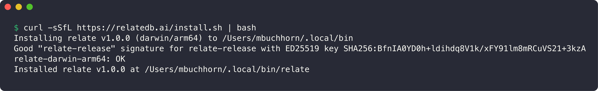
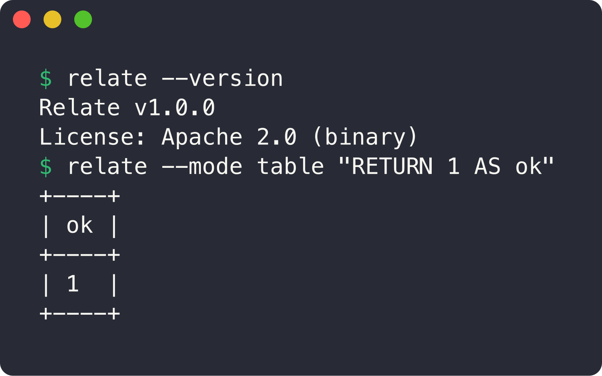
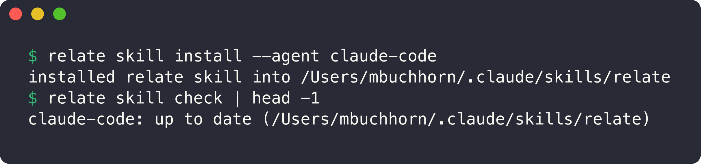
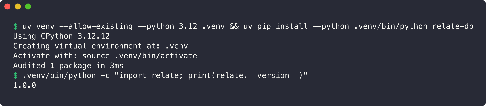
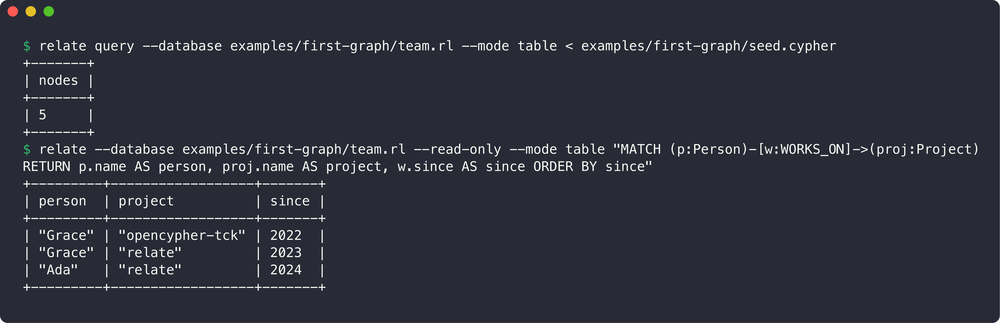
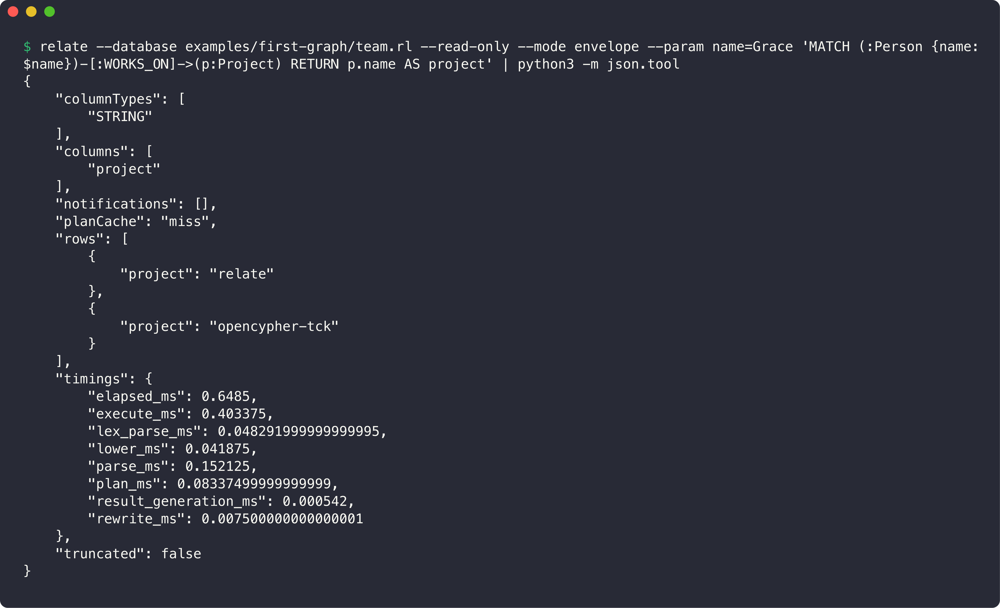
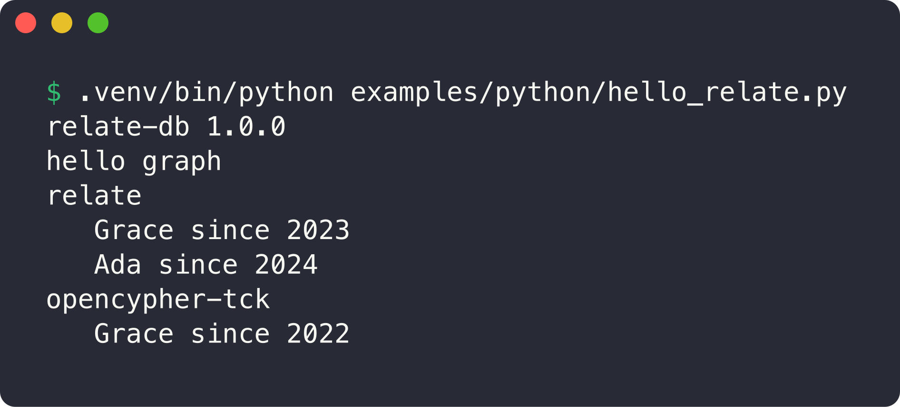
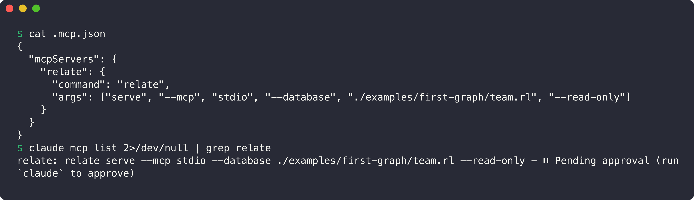

# Install & set up: Relate + ElevenLabs

Every screenshot below is a real run on a MacBook (Apple silicon, macOS 26) on **Nov 11, 2026**, with **Relate v1.0.0**.
Regenerate them any time with `./scripts/screenshots.sh` (needs [`freeze`](https://github.com/charmbracelet/freeze): `brew install charmbracelet/tap/freeze`).

Official docs: **<https://relatedb.ai>** · [Install guide](https://relatedb.ai/docs/get-started/install) · [GitHub](https://github.com/relatedb/relate) · [Docs index for agents (llms.txt)](https://relatedb.ai/docs/llms.txt)

## TL;DR

```bash
curl -sSfL https://relatedb.ai/install.sh | bash && relate skill install --agent claude-code
```

Then, for this repo:

```bash
git clone https://github.com/ma3u/relate-hackathon-team && cd relate-hackathon-team
uv venv --python 3.12 .venv && uv pip install --python .venv/bin/python relate-db elevenlabs python-dotenv
relate query --database examples/first-graph/team.rl --mode table < examples/first-graph/seed.cypher
cp .env.example .env   # then paste your ELEVENLABS_API_KEY into .env
```

## Prerequisites

| Tool | Why | Check |
|---|---|---|
| macOS or Linux (amd64/arm64); Windows amd64 also has a binary | Relate binary | |
| `curl`, `ssh-keygen` (OpenSSH) | the installer verifies the release signature | `ssh-keygen -h` |
| [`uv`](https://docs.astral.sh/uv/) | Python 3.12 venv for `relate-db` and ElevenLabs | `uv --version` |
| [Claude Code](https://claude.com/claude-code) (optional) | agent skill + MCP | `claude --version` |

---

## 1. Install the Relate CLI

```bash
curl -sSfL https://relatedb.ai/install.sh | bash
```

The script downloads the latest release for your OS and CPU, then **checks the signature on `SHA256SUMS` against a pinned ED25519 key, and the binary's SHA-256**. If any check fails, it installs nothing. It installs only to `~/.local/bin`, with no `sudo`.



If `~/.local/bin` isn't on your `PATH`, add this to `~/.zshrc`:

```bash
export PATH="$HOME/.local/bin:$PATH"
```

> On first use Relate prints `relate collects anonymous usage metrics; disable anytime: relate telemetry off`. To opt out: `relate telemetry off`.

Keep it current with `relate upgrade --check` / `relate upgrade`.

## 2. Verify

```bash
relate --version
relate --mode table "RETURN 1 AS ok"
```



Without `--database` the statement runs against an in-memory store that forgets everything when the process exits.

## 3. Install the agent skill (Claude Code)

```bash
relate skill install --agent claude-code
relate skill check
```

This copies `SKILL.md` and 15 reference files into `~/.claude/skills/relate`, straight from the binary, with no network needed. Claude Code then knows the CLI, flags, exit codes and safe defaults. Other agents work too: `cursor`, `windsurf`, `copilot`, `gemini-cli`, `cline`, `codex`, … (`relate skill install` with no flag installs for every agent it detects).



Optional task skills (agent memory, GraphRAG, schema design, query tuning, migrating from vector search):

```bash
npx skills add https://relatedb.ai --skill relate-agent-memory
```

## 4. Python client (`relate-db`)

macOS ships Python 3.9, so we use a uv-managed **Python 3.12** venv in `.venv/` (git-ignored):

```bash
uv venv --python 3.12 .venv
uv pip install --python .venv/bin/python relate-db
.venv/bin/python -c "import relate; print(relate.__version__)"
```



The package is `relate-db`; the import is `import relate`.

## 5. First graph: create, persist, query

[`examples/first-graph/seed.cypher`](../examples/first-graph/seed.cypher) creates 3 `Person` nodes, 2 `Project` nodes and 5 relationships (`WORKS_ON`, `MAINTAINS`, `KNOWS`). Running it with `--database` creates a **single-file store**, `team.rl`:

```bash
relate query --database examples/first-graph/team.rl --mode table < examples/first-graph/seed.cypher
relate --database examples/first-graph/team.rl --read-only --mode table \
  "MATCH (p:Person)-[w:WORKS_ON]->(proj:Project) RETURN p.name AS person, proj.name AS project, w.since AS since ORDER BY since"
```



`*.rl` files are git-ignored, so re-run the seed after cloning.

### Agent-ready JSON (the "envelope")

Agents should use `--mode envelope` (column names and types, rows, notifications, timings, `truncated`) and pass values as `--param`, never by pasting them into the Cypher:

```bash
relate --database examples/first-graph/team.rl --read-only --mode envelope --param name=Grace \
  'MATCH (:Person {name: $name})-[:WORKS_ON]->(p:Project) RETURN p.name AS project'
```



Exit codes to branch on: `0` ok · `1` runtime · `2` usage · `5` conflict/locked · `6` rejected statement · `7` timeout.

### Same store from Python

[`examples/python/hello_relate.py`](../examples/python/hello_relate.py) opens an in-memory store and then the `team.rl` built by the CLI. It's the same engine, so the same Cypher works:

```bash
.venv/bin/python examples/python/hello_relate.py
```



## 6. Relate over MCP (Claude Code)

[`.mcp.json`](../.mcp.json) registers a **read-only** Relate MCP server on the example store. It exposes two tools, `read_cypher` and `get_schema`:

```json
"relate": {
  "command": "relate",
  "args": ["serve", "--mcp", "stdio", "--database", "./examples/first-graph/team.rl", "--read-only"]
}
```



The first time you run `claude` in this folder, **approve the project MCP servers** ("Pending approval" in the screenshot). Remove `--read-only` only when an agent should be allowed to write.

---

## 7. ElevenLabs (voice-over for the ≤ 3 min demo video)

Installed into the same `.venv`: the official **`elevenlabs`** Python SDK (v2.77) and `python-dotenv`. The **ElevenLabs MCP server** (`elevenlabs-mcp`, run via `uvx`) is registered in `.mcp.json`, so Claude Code can generate speech, list voices, etc.

### 7.1 Add your API key (one-time, you do this)

1. Create a key at <https://elevenlabs.io/app/settings/api-keys>. The free tier is enough to test.
2. `cp .env.example .env` and paste the key after `ELEVENLABS_API_KEY=`.
   `.env` is in `.gitignore`. **Never commit it, and never paste it into an issue or chat.**

### 7.2 Generate narration from a script

```bash
.venv/bin/python scripts/voiceover.py --list-voices                    # pick a voice id
.venv/bin/python scripts/voiceover.py docs/demo/voiceover-sample.txt   # -> media/voiceover-sample.mp3
.venv/bin/python scripts/voiceover.py docs/demo/script.txt --voice <id> -o media/demo.mp3
```

[`scripts/voiceover.py`](../scripts/voiceover.py) uses the `eleven_multilingual_v2` model (English and German) and writes MP3s to `media/` (git-ignored). Merge with a screen recording via `ffmpeg`:

```bash
ffmpeg -i screen.mov -i media/demo.mp3 -map 0:v -map 1:a -c:v copy -shortest demo.mp4
```

### 7.3 ElevenLabs inside Claude Code (MCP)

`.mcp.json` passes the key from your **shell environment** (Claude Code expands `${ELEVENLABS_API_KEY}`, but it doesn't read `.env`). So start Claude like this:

```bash
set -a; source .env; set +a; claude
```

Then approve the `elevenlabs` server. Until the key is set, `claude mcp list` warns `Missing environment variables: ELEVENLABS_API_KEY`. That's expected.

> 💡 The hackathon rules require the video to be your own work and any third-party material to be used with permission. AI voice from your own ElevenLabs account is fine, but **mention it in the submission's "AI tools used" statement**.

---

## Troubleshooting

| Symptom | Fix |
|---|---|
| `relate: command not found` | add `~/.local/bin` to `PATH` (step 1) |
| `skill: no supported agents detected` | pass `--agent claude-code` explicitly |
| MCP server "Pending approval" | run `claude` in the repo and approve |
| MCP `read_cypher` fails, store missing | a read-only open never creates a store: run the seed in step 5 |
| `ELEVENLABS_API_KEY is not set` | create `.env` from `.env.example` (step 7.1) |
| ElevenLabs MCP "Missing environment variables" | start `claude` with the `source .env` line in 7.3 |
