# Klarbefund + Apple Health → local Relate graph → Claude

Your lab reports (scanned with Klarbefund) and your Apple Health weekly means land in a **Relate graph on your own Mac**, over your own Wi-Fi, encrypted and pinned to that one Mac. No cloud is involved in getting the data to the Mac. Claude (Desktop or Code) can then read the graph through Relate's MCP server, read-only. **Note:** whatever Claude reads to answer you (query results) is sent to Anthropic's API over TLS. Use a local model as the MCP client if nothing may leave the Mac.

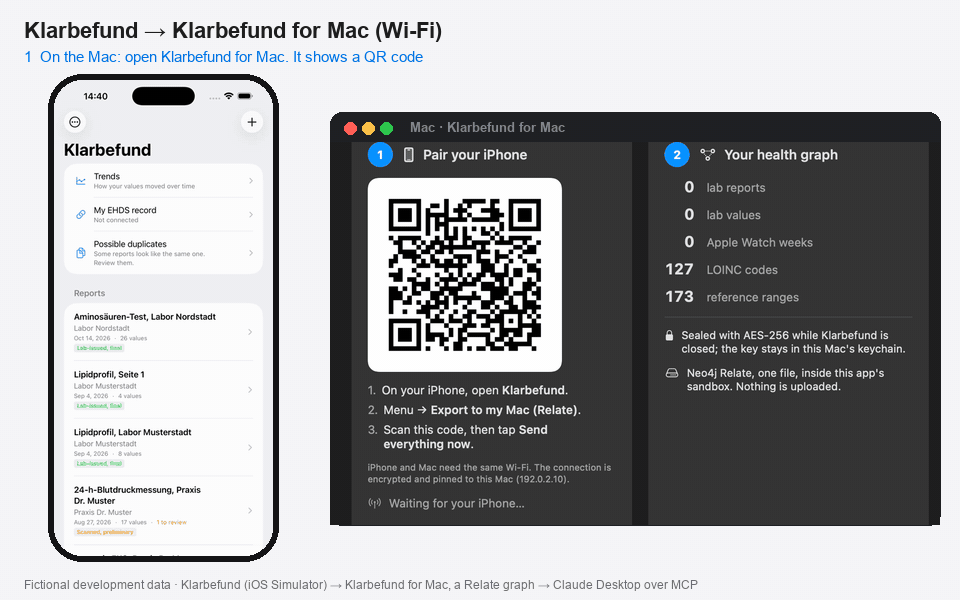

*The whole way with fictional development data: Klarbefund in the iOS Simulator, a scratch receiver and graph on the Mac, and the MCP exchange Claude Desktop uses. Made by [`scripts/flow_gifs.py`](../scripts/flow_gifs.py).*

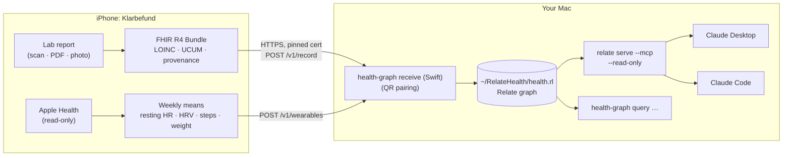

> **Nov 13, 2026: no scripts any more.** [Klarbefund for Mac](MAC.md) replaces the receiver, the vault script and the Claude config: install it from the same [TestFlight link](https://testflight.apple.com/join/ssADSXX6), scan its QR code with Klarbefund (iPhone build 15 or later), and click **Connect Claude Desktop**. It keeps the graph sealed with AES-256-GCM while it is closed (key in the keychain), and its TLS is Apple's own. The command-line route below stays for developers.
>
> **Nov 12, 2026:** the Mac side is now Swift, Klarbefund can keep the **same graph on the iPhone** (Menu → Privacy and sharing → Health graph on this iPhone), and it can **send over a USB cable** when the Mac is not on the same Wi-Fi (`scripts/health_vault.sh usb`): see [SWIFT.md](SWIFT.md).
>
> **Status (Nov 11, 2026):** working end to end **on a real iPhone 17 Pro over Wi-Fi** ([results](#real-iphone-run-nov-11-2026)) and in the iOS Simulator (the app screenshots below are from the Simulator, with Klarbefund's fictional demo data). Klarbefund code: branch `feat/klarbefund-local-relate-main` of [MinimumViableHealthDataspacev2](https://github.com/ma3u/MinimumViableHealthDataspacev2). In the current app the entry is under **Menu → Privacy and sharing → Export to my Mac (Relate)**.

---

## 1. On the Mac: start the receiver

One-time setup is in [INSTALL.md](INSTALL.md) (Relate CLI, `.venv` with `relate-db`). Then:

```bash
cd ~/projects/Neo4j-relate
scripts/health_vault.sh create     # once: AES-256 encrypted disk image, password in your Keychain
scripts/health_vault.sh receive    # unlock it, then start the receiver
```

`receive` builds and runs the **Swift** receiver ([SWIFT.md](SWIFT.md)) as `health-graph receive --db ~/RelateHealth/health.rl --require-mount` (`HEALTH_GRAPH_RECEIVER=python` runs the Python one, same contract and same pairing): the receiver refuses to start unless the encrypted image is open, so no unencrypted store can ever be created. `scripts/health_vault.sh unmount` locks it again; `status` shows whether it's open. (Already have a plaintext `~/RelateHealth/health.rl`? `scripts/health_vault.sh migrate` moves it into a new vault, checks the copy byte for byte, then deletes the plaintext file.)

To look at your graph in 3D, run `scripts/health_vault.sh graph3d`. It unlocks the vault and takes the newest graph: Klarbefund for Mac's snapshot or the receiver's store. It builds `~/RelateHealth/graph3d/index.html` and serves it on `http://127.0.0.1:8799` for this Mac only. The page holds your values, so it never leaves the vault, and `scripts/graph3d.py` refuses to write into the repository. The page opens on your current risks, then the measures, then the documents.

`receive` prints a QR code in the terminal:

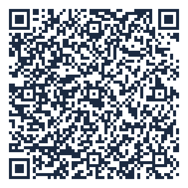

*(Example with a dummy token. Your terminal shows the real one; never share it.)*

The code carries a `klarbefund://relate` link:

| Field | Meaning |
|---|---|
| `url` | `https://<this Mac's Wi-Fi address>:8787` |
| `token` | 256-bit bearer token; requests without it get `401` |
| `fp` | SHA-256 of the receiver's certificate. **The app pins it**, so only this Mac can receive |
| `name`, `store` | shown in the app so you can see where your values go |

The certificate, key and token live in `~/.config/relate-health-graph/` (mode 0600). `--rotate` issues a new token (phones must scan again). `--port`, `--host` and `--qr-png` are optional.

> **Keep real data out of git.** `~/RelateHealth/health.rl` is outside every repository on purpose, the same rule as the EHDS repo: *no health data in a repo, not even git-ignored.* The repo's `health.rl` and `demo-phone.rl` hold synthetic demo data only.

## 2. In Klarbefund: pair by QR code

**Get the app:** [Klarbefund on TestFlight](https://testflight.apple.com/join/ssADSXX6) (public beta, iPhone with iOS 26+). The public group gets a build after Apple's Beta App Review, so "Export to my Mac (Relate)" appears there once a build with it (13 or later) has passed review. Hackathon teammates can be added as internal testers to get it right away.


**Menu (⋯) → Export to my Mac (Relate)**

| Menu entry | Not paired yet | Paired | Reports sent | Apple Health sent |
|---|---|---|---|---|
| 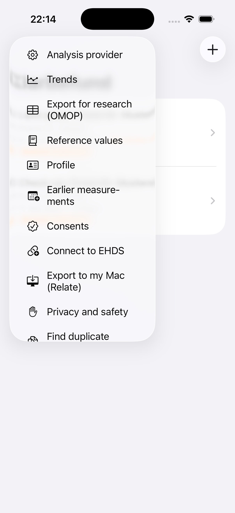 | 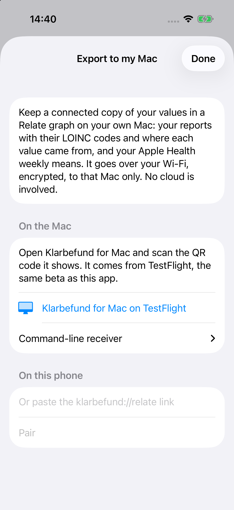 | 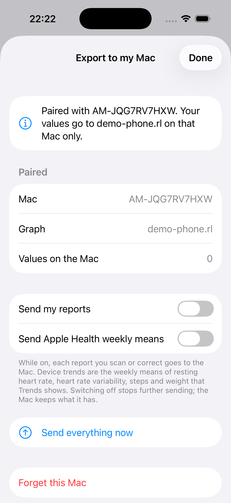 | 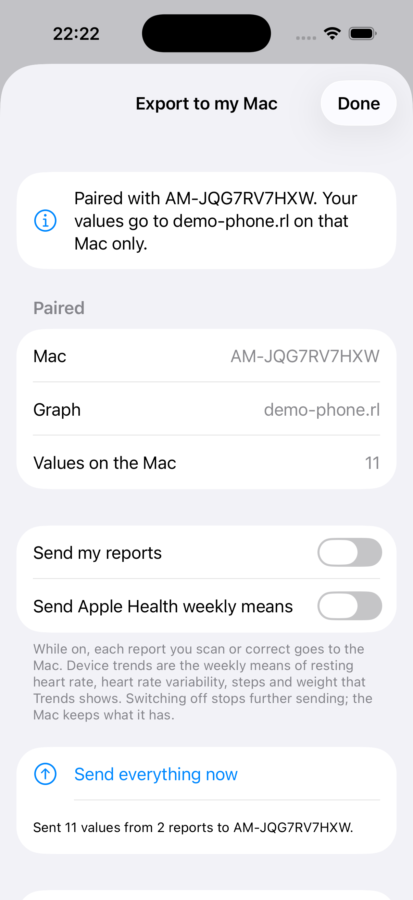 | 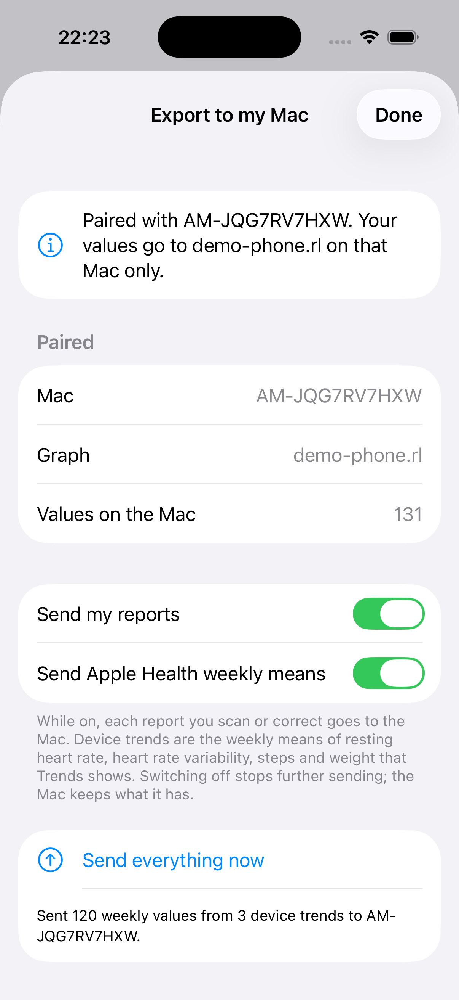 |

1. **Scan the Mac's QR code**, or point the iPhone **Camera** app at it: it opens Klarbefund via the `klarbefund://relate` link. A pasted link works too, for the Simulator and UI tests.
2. Klarbefund checks the link: **https only**, a **private / `.local` address only**, a 64-hex fingerprint and a strong token. Then it calls `GET /v1/status` over the pinned connection and stores the pairing in the Keychain (`ThisDeviceOnly`).
3. Switch on **Send my reports** and/or **Send Apple Health weekly means**, or tap **Send everything now**.

From then on:
- Every report you scan or correct is sent **automatically** (only changed ones; a re-send *replaces* the report on the Mac, never duplicates).
- Apple Health weekly means are sent when the app starts (same series the Trends screen shows).
- **Forget this Mac** stops sending; the graph on the Mac stays until you delete it.

### What exactly is sent

| Klarbefund source | Endpoint | Graph result |
|---|---|---|
| A report: `ReportExport.fhirJSON` (FHIR R4 Bundle: Patient, DiagnosticReport, DocumentReference, Observations, Provenance), header `X-Klarbefund-Report: <uuid>` | `POST /v1/record` | `DiagnosticReport -HAS_RESULT-> Observation -CODED_BY-> LoincCode`, `DERIVED_FROM` document, `Provenance`, OMOP measurements |
| Apple Health: `WearableFHIR.json` (weekly-mean Observations with `effectivePeriod`) | `POST /v1/wearables` | `Observation {sourceKind: 'device-weekly-mean', sourceReport: 'apple-health-weekly'}` on the **same `LoincCode`** as lab values |

### Apple Health metrics (weekly means)

| Metric (HealthKit) | LOINC | Unit | Joins lab data? |
|---|---|---|---|
| Resting heart rate | 40443-4 | /min | ✅ resting HR on ECG/Holter sheets |
| Heart rate variability (SDNN) | 80404-7 | ms | |
| Steps | 41950-7 | /d | |
| Body weight | 29463-7 | kg | ✅ weight on lab sheets and body-composition scales |
| Exercise minutes | 55411-3 | min/d | |
| **Cardio fitness (VO2 max)** | 94122-9 | mL/min/kg | ✅ VO2 peak from a spiroergometry (CPET), same code |
| **Respiratory rate** | 9279-1 | /min | |
| **Blood oxygen (SpO₂)** | 59408-5 | % | |
| **Active energy** | 41981-2 | kcal/d | |
| **Body fat** | 41982-0 | % | ✅ body-fat % from DXA / body-composition reports |
| **Sleep, all stages** | 93832-4 | h/d | |
| **Deep / REM / light (core) sleep** | 93831-6 / 93829-0 / 93830-8 | min/d | |

**New in this version** (bold). Sleep comes from HealthKit sleep analysis: a night belongs to the day you woke up, "in bed" and "awake" don't count, and if two sources logged the same night (Watch and iPhone) the one with more sleep is used instead of adding both. Klarbefund asks for read access again when new types are added. The EHDS Hub still accepts only its original metrics and skips the rest; the local graph keeps all of them.

These are the **same payloads and replace rules** as the EHDS Hub's `/api/patient/app/record` and `/app/wearables`, so the same graph can later be pushed to the Hub with consent (`relate push`). Body weight from a lab sheet and from Apple Health meet on `LoincCode 29463-7`, and the `trend` query shows both:

```bash
.venv/bin/python -m health_graph query --db ~/RelateHealth/health.rl reports
.venv/bin/python -m health_graph query --db ~/RelateHealth/health.rl trend --param loinc=29463-7
.venv/bin/python -m health_graph query --db ~/RelateHealth/health.rl wearables
```

Result of the Simulator run (demo data: 2 reports, 3 Apple Health trends × 40 weeks):

```text
| date       | lab               | document                       | source          | values | hubReady |
| 2026-03-11 | Praxis Dr. Muster | Check-up, Praxis Dr. Muster    | ocr-transcribed | 3      | 3        |
| 2026-09-04 | Praxis Dr. Muster | Lipid panel, Praxis Dr. Muster | ocr-transcribed | 8      | 8        |
Observation 131 · OMOPMeasurement 91 · LoincCode 11
```

## Real iPhone run (Nov 11, 2026)

Klarbefund on an iPhone 17 Pro, paired by QR code with the receiver on a MacBook over home Wi-Fi. One tap on **Send everything now**:

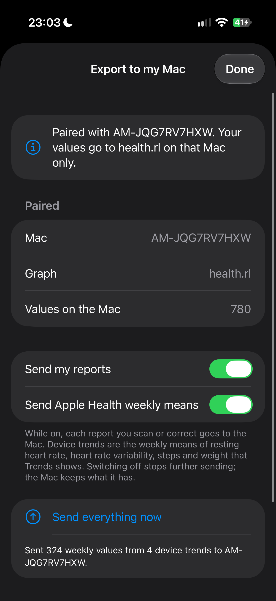

*On the phone: paired with the Mac, both switches on, **780 values on the Mac**, "Sent 324 weekly values from 4 device trends".*

On the Mac, the receiver logs each report and the Apple Health series as they arrive:

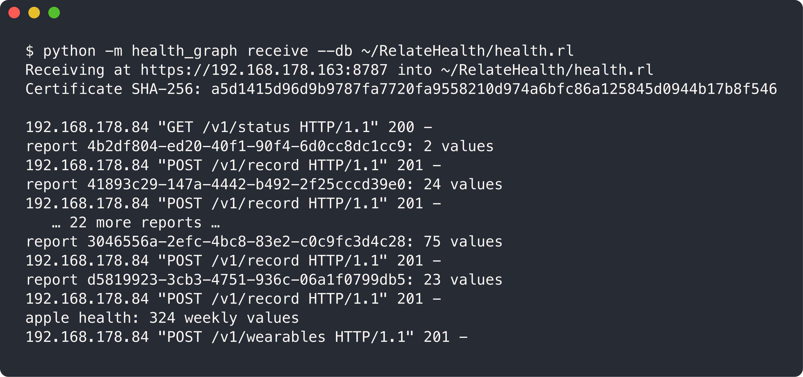

What the graph holds afterwards. **Counts only**: real health values never go into this repository.

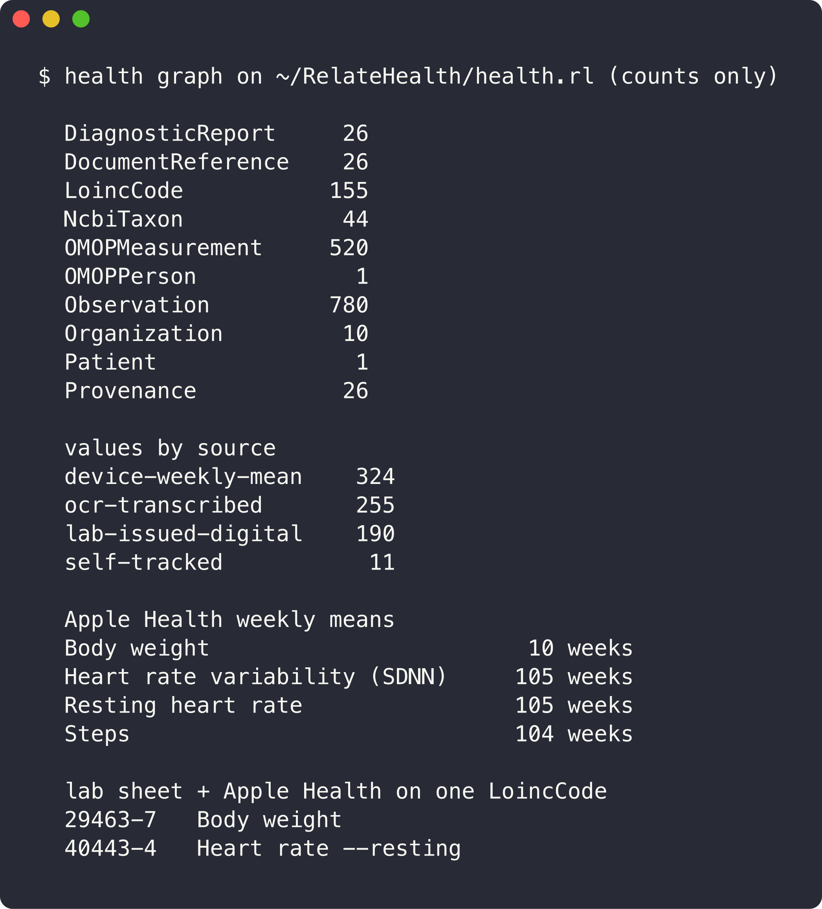

- **26 reports, 456 lab values**: 255 OCR-read, 190 from digital lab reports, 11 entered by hand, each with its provenance. 155 distinct LOINC codes; 44 microbiome organisms as NCBI taxa (no LOINC term exists).
- **Apple Health: 324 weekly means**: resting heart rate and HRV (105 weeks each), steps (104), body weight (10).
- **Connected context:** body weight and resting heart rate from lab sheets and from Apple Health land on the **same `LoincCode`**, so one Cypher query follows a value across both sources.
- 520 OMOP CDM measurements were derived locally, ready for research tooling, without leaving the Mac.

## 3. Ask Claude about your graph

`relate serve --mcp stdio --read-only` exposes two tools, `read_cypher` and `get_schema`. Both are registered as **`klarbefund-health`**, on a snapshot of `~/RelateHealth/health.rl` taken inside the vault when the server starts:

**Claude Code** (user scope, every project):

```bash
claude mcp add --scope user klarbefund-health -- \
  ~/projects/Neo4j-relate/scripts/health_vault.sh mcp   # unlocks the vault, then relate serve --mcp --read-only
claude mcp get klarbefund-health      # Status: ✔ Connected
```

### Claude Desktop, step by step

Claude Desktop starts the MCP server itself, from its configuration file
`~/Library/Application Support/Claude/claude_desktop_config.json`, and reads that
file only when it starts. It also keeps the configuration in memory and writes it
back, so **an edit made while Claude Desktop runs can be lost** (it happened on
Nov 12, 2026: the entry was gone an hour later). Edit it only while the app is closed.
[`scripts/claude_desktop.sh`](../scripts/claude_desktop.sh) does that for you.

1. **Check the server works**, without Claude:
   ```bash
   scripts/health_vault.sh mcp </dev/null   # unlocks the vault; "MCP (stdio) serving", then exits
   ```
2. **Register it**, either way:
   - With the app open: run
     ```bash
     scripts/claude_desktop.sh --wait
     ```
     then quit Claude Desktop (⌘Q). The script waits for it to close, backs up the
     configuration, adds `klarbefund-health`, and opens Claude Desktop again.
   - With the app already closed: `scripts/claude_desktop.sh`, then open Claude Desktop.
   - By hand: quit Claude Desktop (⌘Q), back up the file, and add under `mcpServers`,
     next to any servers you have, with the absolute path (Claude Desktop does not use
     your shell's `PATH`):
     ```json
     "klarbefund-health": {
       "command": "/Users/<you>/projects/Neo4j-relate/scripts/health_vault.sh",
       "args": ["mcp"]
     }
     ```
3. **Allow the vault once.** On the first start macOS may ask whether `security` may
   use the Keychain item `relate-health-vault`: **Always Allow**. That is the vault's
   password, read to unlock the encrypted image; it is never printed.
4. **Check it is there.** In a new chat, open the tools menu below the message
   field: **klarbefund-health** with `read_cypher` and `get_schema`.
   `scripts/claude_desktop.sh --status` shows the configuration from the Mac side.
5. **Ask.** For example *"Using klarbefund-health: how many reports and lab values
   are in my graph?"* Claude asks before its first tool call; allow it.

| Symptom | What to do |
|---|---|
| klarbefund-health is not in the tools menu | `scripts/claude_desktop.sh --status`; if it says "not configured", the app overwrote it: run step 2 again |
| It is listed but fails | read `~/Library/Logs/Claude/mcp-server-klarbefund-health.log`; run step 1 |
| Values sent from the phone are missing | Claude reads the snapshot taken at start: quit and reopen Claude Desktop |
| Stop using it | quit Claude Desktop (⌘Q), then `scripts/claude_desktop.sh --remove` |

In this repo, Claude Code also sees `health-graph` (synthetic `./health.rl`) from `.mcp.json`, plus the Relate skill (`~/.claude/skills/relate`), so it writes good Cypher.

Example prompts:
- *"Using klarbefund-health: how did my LDL cholesterol develop across reports? Show the printed reference text and whether each value was OCR-read or digital."*
- *"Which of my values have no LOINC code, and why?"*
- *"Compare my Apple Health resting heart rate weekly means with the dates of my lab reports."*

> Claude reads the snapshot taken when the server started. After new values arrive, reconnect it (Claude Code: `/mcp` → reconnect; Claude Desktop: quit and reopen) for a fresh one.
> Like Klarbefund itself, answers are **not medical advice and give no normal/abnormal verdicts**. Ask your doctor.

## Pairing a real iPhone

1. Mac and iPhone on the **same Wi-Fi** (no guest network or client isolation).
2. The **macOS firewall** must let Python accept connections. The first time the receiver starts, macOS may ask *"Do you want the application python3.12 to accept incoming network connections?"*. Click **Allow**. If you missed it: System Settings → Network → Firewall → Options → add `~/.local/share/uv/python/cpython-3.12*/bin/python3.12` → Allow.
3. iOS asks once for **Local Network** access ("Klarbefund sends your values to your own Mac on this network…"). Allow it.
4. Scan the QR code. The address in it is the Mac's Wi-Fi IP. If the Mac has several interfaces, pass `--host <ip>`.

## Security & privacy model

| Threat | Mitigation |
|---|---|
| Someone sniffs the Wi-Fi | TLS 1.2+ only; the app refuses `http://` links |
| A look-alike server on the same network | App pins the certificate's SHA-256 from the QR code; any other certificate → nothing is sent |
| A QR code pointing somewhere else | Only private / loopback / `.local` addresses accepted; public hosts refused before any request |
| Another device posts junk | 256-bit bearer token; private-network clients only; 10 MB body limit; FHIR Bundle required |
| A stalled client blocks the receiver | TLS per connection with a 15 s handshake timeout; one writer at a time with retry on a locked store |
| Data at rest on the Mac | Relate stores the graph unencrypted, so it lives inside an **AES-256 encrypted disk image** opened only while used ([`scripts/health_vault.sh`](../scripts/health_vault.sh)), password in the Keychain, FileVault underneath. While locked, `~/RelateHealth` is empty and the receiver refuses to start (`--require-mount`). If you use Time Machine, the image is backed up encrypted. |
| Data sent to Claude | MCP runs locally over stdio, but Claude Desktop/Code send the rows a query returns to Anthropic's API (TLS). Ask aggregate questions, or use a local LLM client for full sovereignty |
| Data at rest on the phone | Unchanged: Klarbefund's sealed AES-GCM store; pairing in the Keychain (`ThisDeviceOnly`) |

The phone sends only after an explicit switch (or button) in this screen. The export itself sends nothing to the EHDS Hub or any other server.

## Lessons learned (from the Python receiver; the Swift one keeps every fix)

- **Apple's TLS stack rejects certificates whose EC key uses explicit curve parameters.** macOS's LibreSSL writes them unless you pass `-pkeyopt ec_param_enc:named_curve`. The symptom is `TLSV1_ALERT_DECODE_ERROR` on the server and `-1200 / -9859` on the client, *before* any pinning delegate runs. The receiver now generates v3, named-curve, serverAuth certificates, replaces bad ones automatically, and a test guards it.
- **Klarbefund exported report dates as the UTC day.** `ISO8601DateFormatter` defaults to GMT, so a report dated at local midnight in Berlin became the day before, in the EHDS Hub sync and the FHIR file too. Fixed in the same branch (`ReportExport.swift`, `timeZone = .current`).
- Open the store **read-only** for status reads, serialize writes, and retry on `storage locked`: the app sends the reports and the Apple Health series at the same moment.

## Files

| Where | What |
|---|---|
| [`swift/mac`](../swift/mac) | Swift receiver + CLI (default): HTTPS, QR pairing, certificate and token ([SWIFT.md](SWIFT.md)) |
| [`health_graph/receiver.py`](../health_graph/receiver.py) | Python reference receiver, same contract |
| [`health_graph/fhir.py`](../health_graph/fhir.py) | `parse_bundle` (reports), `parse_wearables` (Apple Health) |
| [`tests/test_receiver.py`](../tests/test_receiver.py) | pinning, token, concurrency, v3 named-curve certificate |
| Klarbefund `Sources/Shared/LocalRelateLink.swift` | link parsing and checks, certificate pin (unit-tested) |
| Klarbefund `Sources/MeinBefund/LocalRelateExport.swift` | pairing, pinned URLSession, report and wearable export |
| Klarbefund `Sources/MeinBefund/LocalRelateView.swift` | the sheet; menu entry and `klarbefund://relate` deep link in `ContentView.swift` |
