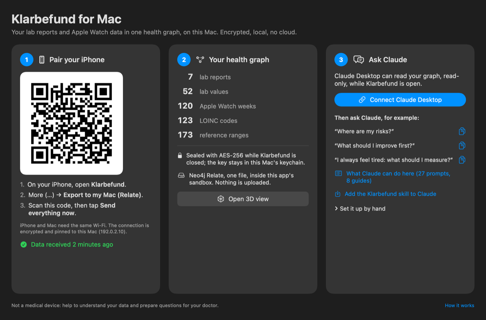
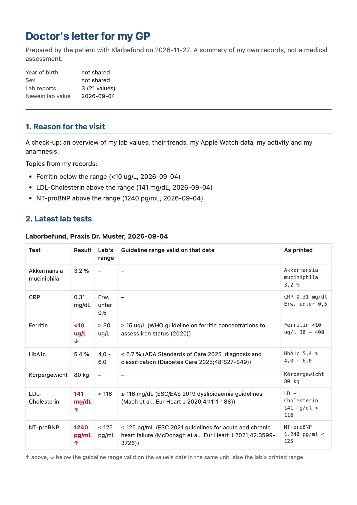
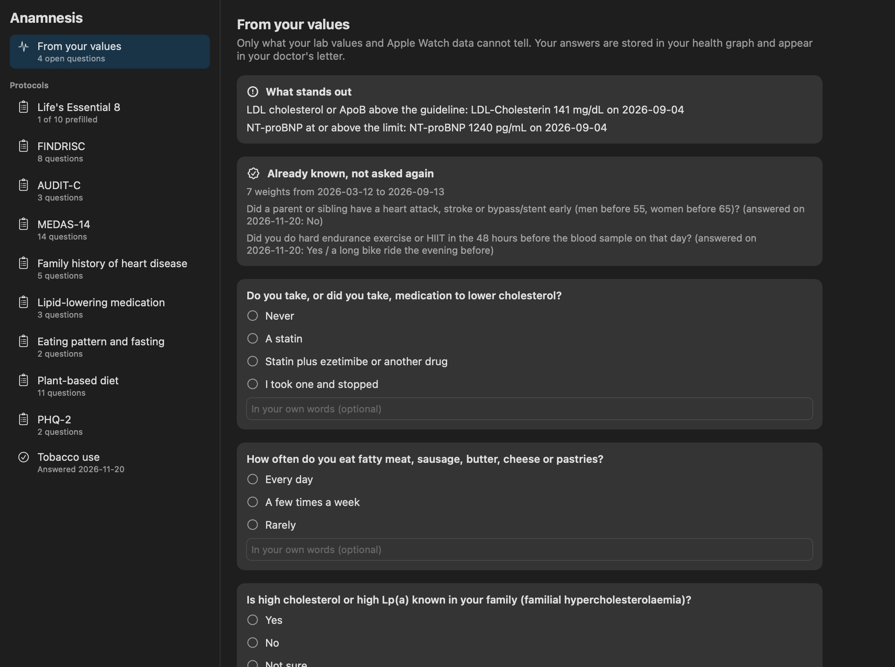

# Klarbefund for Mac

Klarbefund for Mac is the no-scripts way to keep your health graph on your Mac and ask Claude about it. It pairs with Klarbefund on the iPhone, keeps the Neo4j Relate graph sealed in its own sandbox, and connects Claude Desktop with one click. It ships under the same TestFlight link as the iPhone app.

> **Status, Nov 16, 2026:** Mac build 9 is in TestFlight. It opens your graph in 3D inside the app (*Open 3D view*), asks the validated anamnesis protocols (Life's Essential 8, FINDRISC, AUDIT-C, MEDAS-14, PHQ-2, tobacco, family history, statin months, diet and the plant-based follow-up), stores what a reading concluded (findings linked to the values they are about), and brings the Klarbefund skill for Claude. The Claude extension now carries the build number (1.0.9) and lists its seven tools. Both apps stay in TestFlight while in development and testing; neither is submitted to the App Store. The public TestFlight link offers the Mac build once Apple's Beta App Review passes (iPhone build 15 is already live there). Claude Desktop answers through the "Klarbefund Health Graph" extension while the app is open.



## For people

1. **Install** Klarbefund for Mac from TestFlight: [testflight.apple.com/join/ssADSXX6](https://testflight.apple.com/join/ssADSXX6) (open the link on the Mac, or in the TestFlight app on the Mac).
2. **Pair your iPhone.** Open Klarbefund for Mac. On the iPhone open Klarbefund → More (…) → **Export to my Mac (Relate)** and scan the QR code the Mac shows. Then tap **Send everything now**. Mac and iPhone need the same Wi-Fi; the connection is encrypted and pinned to this Mac.
3. **See your graph.** The middle card counts your lab reports, lab values, Apple Watch weeks, LOINC codes and the 173 reference ranges the app brings along. **Open 3D view** shows all of it as an interactive 3D graph in its own window: your main risk in the middle, turning for 30 seconds, then the evidence, the anamnesis, your values and documents. Questionnaires you answer there are stored in your graph with *Save to my graph*. The window builds its page on this Mac; only the 3D library is loaded from jsDelivr, none of your data.
   - **Doctor's letter** prepares your visit: one A4 letter for your GP (an overview of everything) or for a specialist (one health risk, its markers and the risks it connects to), in German or English. It holds your latest lab tests exactly as printed (value, unit, the lab's range, report, lab and the printed line), every marker's trend compared only with a guideline range in the same unit that applied on the value's date (the source named), your Apple Watch vitals and activity (the recent 12 weeks against the year before), your anamnesis answers in your own words, and plain questions for the doctor. A value seen in two reports counts once. **Save as PDF…** writes paginated A4 pages; **Print…** opens the print panel. It is built on this Mac from the read-only snapshot; nothing is loaded from anywhere. Not a diagnosis: every number can be checked on the paper it came from.
   - **Anamnesis** asks, natively, what your data cannot tell: first what stands out in your own values and only the questions that leaves (what your data or an earlier answer already settles is listed, not asked), then the validated protocols one at a time, prefilled from your earlier answers and year of birth. **Save** stores the answers in your graph (coded with SNOMED CT where a code exists), and they appear in the doctor's letter.

   
   
4. **Connect Claude.** Install [Claude Desktop](https://claude.ai/download), then click **Connect Claude Desktop**. Claude asks to install "Klarbefund Health Graph": click **Install**, start a new chat, and ask, for example:
   - "Where are my risks?"
   - "What should I improve first?"
   - "I always feel tired: what should I measure?"

   These and 24 more are in Claude's **+** menu as prompts of the extension; **What Claude can do here** in step 3 lists them all, with the guides Claude can read. "My personal anamnesis, from my risk profile" takes the whole reading: your main risk, the questionnaires that matter for it (prefilled from your data, the rest asked), the scores, and the findings, stored in your graph once you confirm them. What the server offers and how it is secured: [MCP.md](MCP.md).
5. **Add the skill (optional).** **Add the Klarbefund skill to Claude** in step 3 saves `klarbefund-anamnesis.zip`, the method without any data. In Claude: Customize → Skills → + → Upload a skill. Claude then takes the anamnesis the same way whenever your question fits, without picking a prompt.
6. **Or another AI.** Step 3 is *Ask your AI*: Claude, ChatGPT, Gemini or a local model. Each starts the same helper inside Klarbefund for Mac (`/Applications/Klarbefund.app/Contents/Helpers/klarbefund-mcp`), read-only. The app shows each setup with the path filled in and a copy button:
   - **ChatGPT:** the ChatGPT app for Mac and Codex CLI share one setup (`~/.codex/config.toml`). In ChatGPT: Settings → MCP servers → Add server → STDIO, name `klarbefund-health`, the helper as command; save, then restart. In Terminal: `codex mcp add klarbefund-health -- '<helper>'`. ChatGPT in the browser cannot reach a server on your Mac.
   - **Gemini:** Gemini CLI, `gemini mcp add -s user klarbefund-health '<helper>'`, then start `gemini` in a folder you trust (in an untrusted folder it switches MCP servers off) and type `/mcp`. Checked with Gemini CLI 0.66.0: *klarbefund-health … Connected*.
   - **Local model:** *Add to LM Studio* (LM Studio 0.3.17 or later) hands LM Studio the server entry; pick a model that supports tool use. The model then runs on your Mac and nothing from the graph leaves it. Ollama has no MCP support of its own; an MCP client in front of it takes the same `mcpServers` JSON.

   Where the rows go depends on the AI, and step 3 says it under each setup: Claude, ChatGPT and Gemini run in their makers' clouds, so the rows the model reads go into your conversation there; a local model keeps everything on the Mac.

**Updating.** TestFlight updates the app in `/Applications`; your graph is not inside the app and stays. Then:
- Quit Klarbefund (⌘Q) and open it again. Klarbefund → About Klarbefund shows the build; step 3 lists the prompts (27 in build 9).
- Claude runs its own copy of the extension, so new tools arrive only when it is installed again. When step 3 says "Klarbefund was updated", click **Connect Claude Desktop**. If Claude says the extension is already installed, uninstall it under Settings → Extensions and click Connect again. Uninstalling the extension never touches your health graph.
- Two Klarbefund apps in `/Applications` (TestFlight may add "Klarbefund 2" next to an older copy): keep the newer one and move the other to the Trash. All copies share one sealed graph, so nothing is lost.

**What stays private:** the graph is one file inside the app's sandbox. While Klarbefund for Mac is closed it exists only sealed with AES-256-GCM; the key stays in this Mac's keychain. Claude reads a read-only copy, and only while the app is open: closing the window seals the graph and ends Claude's access. Only the rows Claude asks for go into your conversation.

**No shared Wi-Fi?** The USB-cable transfer needs the command-line receiver (`scripts/health_vault.sh usb`, see [KLARBEFUND.md](KLARBEFUND.md)); the App Store sandbox does not let apps talk to the iPhone over USB.

Not a medical device: it helps you understand your data and prepare questions for your doctor.

## For developers

```bash
cd apps/mac
xcodegen generate
open Klarbefund.xcodeproj      # or: xcodebuild -scheme Klarbefund build
```

Keep archives in `apps/mac/build/archives.noindex/`: Spotlight skips a `.noindex` folder, so macOS never launches an archived build instead of the TestFlight app (on Nov 16, 2026 it opened a build 5 archive, and Claude got its old extension).

| Part | Where | What it does |
| --- | --- | --- |
| App | `apps/mac/Klarbefund/` | SwiftUI window with the three steps; `AppModel` runs `ReceiverServer` from `swift/mac` in-process, on port 8787 (or the next free one). TLS comes from Apple's Network framework; the certificate and key go into the keychain as an identity while the app runs |
| Sealing | `Seal.swift` | `health.rl` ↔ `health.rl.sealed`, AES-256-GCM (CryptoKit), key in the keychain, this device only |
| Knowledge | `swift/Sources/HealthGraph/Knowledge.swift` | `seedKnowledge()`, generated from `health_graph/knowledge.py` by `scripts/gen_swift_cypher.py` (CI checks it is current) |
| Guideline recommendations | `health_graph/guidelines.py`, `swift/Sources/HealthGraph/GuidelineRecommendations.swift` | `python -m health_graph.guidelines extract --manifest <MVHD>/scripts/leitlinien/data/guidelines-manifest.json` reads the guideline PDFs already on this Mac, checks every recommendation box without a language model (wording on the page, modal verb against grade, negation against direction, short version against long), and drops the wording: it writes facts only (box number, grade ⇑⇑ … ⇓⇓, direction, chapter, page, the lab values named, a SHA-256) into the app's inbox. The app stores them on their guideline and links them to the LOINC codes; the 3D view lists them under a lab value with a link to the publisher's PDF at that page. A box that fails a check is kept with `needsReview` and never shown as a recommendation. DEGAM guidelines wait for the DEGAM's consent (`--allow-degam`) |
| Claude | `ClaudeConnect.swift` | builds `Klarbefund Health Graph.mcpb` (manifest, helper, icon) and opens it with Claude Desktop. The extension carries its own copy of the helper and is versioned by build (`1.0.8`), so Claude Desktop sees a new build as an update; the app says when the connected extension is older than itself. Uninstalling the extension in Claude never touches the health graph |
| MCP server | `apps/mac/klarbefund-mcp/main.swift` | MCP over stdio (2026-07-28 and, through `initialize`, 2025-11-25 back to 2024-11-05): `get_schema`, `read_cypher` (read-only, write clauses refused, 500 rows), `anamnesis_plan` and `save_anamnesis_answers`, `doctor_letter` (the doctor's letter as Markdown, from the snapshot), `anamnesis_protocols` and `save_protocol_answers` (answers handed to the app through the app-group `Inbox`, which the app checks, scores and stores with their SNOMED CT codes), `save_assessment` (findings of a reading, stored linked to their values, risks and answers), 27 prompts, 8 guides as resources, and instructions that describe the graph. See [MCP.md](MCP.md) |
| 3D view | `Graph3DView.swift` | *Open 3D view* (step 2): the bundled `scripts/graph3d.html` in a web view, its data built from the read-only snapshot by `HealthStore.graph3DData` (`swift/Sources/HealthGraph/Graph3D.swift`, the same nodes, names and details as `scripts/graph3d.py`; `tests/graph3d_parity.py` compares the two on one store). *Save to my graph* hands a protocol's answers to the app, which stores them. Not yet in the app: the published scores (SCORE2, eGFR, FIB-4 …) and prefill from lab and Apple Watch values; questionnaires are prefilled from earlier answers |
| Doctor's letter | `DoctorLetterView.swift` | *Doctor's letter* (step 2): `HealthStore.doctorLetter(_:)` and `DoctorLetter.html(language:)` (`swift/Sources/HealthGraph/DoctorLetter.swift`, `DoctorLetterRender.swift`; the reads in `health_graph/letter.py`, generated into `Cypher.swift`) in a web view; *Save as PDF…* and *Print…* through WebKit's print operation, A4. `Klarbefund --letter-render STORE.rl --out DIR` (Debug builds) renders the GP and cardiovascular letters of a store in both languages as HTML, Markdown, PDF and a PNG of page 1 |
| Anamnesis | `AnamnesisView.swift` | *Anamnesis* (step 2): `anamnesisPlan` (findings, known, skipped, open questions) and `protocolPlan` (the protocols, prefilled) from the snapshot; saves with `storeAnamnesis` and `storeProtocol`, source `mac-app`, then refreshes the snapshot. `Klarbefund --screenshot PNG --anamnesis STORE.rl` renders it for the docs (add `-AppleLanguages '(de)'` for German) |
| Languages | `Klarbefund/en.lproj`, `de.lproj` | German when the Mac prefers German, else English, as Klarbefund on the iPhone. Window texts in `de.lproj/Localizable.strings` (the English text is the key); the anamnesis questions, answers, protocols and findings in German from `health_graph/german.py`, generated into the Swift data with the English ones (`German.swift`). Answers are stored as before (linkId, codes, the English labels); the German doctor's letter looks the German texts up by linkId and code. The prompts and guides sent to the AI stay English |
| Skill | `SkillExport.swift` | saves the bundled `klarbefund-anamnesis` skill (method only, no data) as the zip Claude's Customize → Skills → Upload takes |
| Catalog | `apps/mac/Shared/MCPCatalog.swift` | the prompts, guides and rules, shared by the helper, the extension manifest and the app's "What Claude can do here" sheet (`MCPCapabilitiesView.swift`) |

The app and the helper are sandboxed and share the app group `38R8Z4P7S8.red.mabu.meinbefund`; the app writes `Snapshot/health.rl` there after each transfer and deletes it on quit. The bundle id is the iPhone app's (`red.mabu.meinbefund`), so both platforms live in one App Store Connect record (universal purchase).

Check the receiver's TLS in a signed Debug build (throwaway identity, one pinned request over the LAN address):

```bash
.build/Build/Products/Debug/Klarbefund.app/Contents/MacOS/Klarbefund --tls-selftest
```

Check the extension with the official validator:

```bash
.build/Build/Products/Debug/Klarbefund.app/Contents/MacOS/Klarbefund --write-extension   # Debug builds only
npx @anthropic-ai/mcpb validate manifest.json   # after unzipping the .mcpb it printed
```
