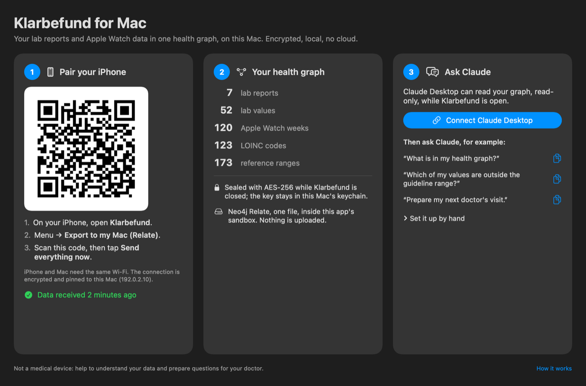

# Klarbefund for Mac

Klarbefund for Mac is the no-scripts way to keep your health graph on your Mac and ask Claude about it. It pairs with Klarbefund on the iPhone, keeps the Neo4j Relate graph sealed in its own sandbox, and connects Claude Desktop with one click. It ships under the same TestFlight link as the iPhone app.

> **Status, Nov 13, 2026:** Mac build 4 is in TestFlight: its knowledge layer adds how the health risks raise each other, from 13 studies (each with its DOI and PubMed link, the markers it examines and the scores it informs), so Claude can follow a value to its evidence. Both apps stay in TestFlight while in development and testing; neither is submitted to the App Store. The public TestFlight link offers the Mac build once Apple's Beta App Review passes (iPhone build 15 is already live there). Claude Desktop answers through the "Klarbefund Health Graph" extension while the app is open.



## For people

1. **Install** Klarbefund for Mac from TestFlight: [testflight.apple.com/join/ssADSXX6](https://testflight.apple.com/join/ssADSXX6) (open the link on the Mac, or in the TestFlight app on the Mac).
2. **Pair your iPhone.** Open Klarbefund for Mac. On the iPhone open Klarbefund → More (…) → **Export to my Mac (Relate)** and scan the QR code the Mac shows. Then tap **Send everything now**. Mac and iPhone need the same Wi-Fi; the connection is encrypted and pinned to this Mac.
3. **See your graph.** The middle card counts your lab reports, lab values, Apple Watch weeks, LOINC codes and the 173 reference ranges the app brings along.
4. **Connect Claude.** Install [Claude Desktop](https://claude.ai/download), then click **Connect Claude Desktop**. Claude asks to install "Klarbefund Health Graph": click **Install**, start a new chat, and ask, for example:
   - "Where are my risks?"
   - "What should I improve first?"
   - "I always feel tired: what should I measure?"

   These and 21 more are in Claude's **+** menu as prompts of the extension; **What Claude can do here** in step 3 lists them all, with the guides Claude can read. What the server offers and how it is secured: [MCP.md](MCP.md).

**What stays private:** the graph is one file inside the app's sandbox. While Klarbefund for Mac is closed it exists only sealed with AES-256-GCM; the key stays in this Mac's keychain. Claude reads a read-only copy, and only while the app is open: closing the window seals the graph and ends Claude's access. Only the rows Claude asks for go into your conversation.

**No shared Wi-Fi?** The USB-cable transfer needs the command-line receiver (`scripts/health_vault.sh usb`, see [KLARBEFUND.md](KLARBEFUND.md)); the App Store sandbox does not let apps talk to the iPhone over USB.

Not a medical device: it helps you understand your data and prepare questions for your doctor.

## For developers

```bash
cd apps/mac
xcodegen generate
open Klarbefund.xcodeproj      # or: xcodebuild -scheme Klarbefund build
```

| Part | Where | What it does |
| --- | --- | --- |
| App | `apps/mac/Klarbefund/` | SwiftUI window with the three steps; `AppModel` runs `ReceiverServer` from `swift/mac` in-process, on port 8787 (or the next free one). TLS comes from Apple's Network framework; the certificate and key go into the keychain as an identity while the app runs |
| Sealing | `Seal.swift` | `health.rl` ↔ `health.rl.sealed`, AES-256-GCM (CryptoKit), key in the keychain, this device only |
| Knowledge | `swift/Sources/HealthGraph/Knowledge.swift` | `seedKnowledge()`, generated from `health_graph/knowledge.py` by `scripts/gen_swift_cypher.py` (CI checks it is current) |
| Claude | `ClaudeConnect.swift` | builds `Klarbefund Health Graph.mcpb` (manifest, helper, icon) and opens it with Claude Desktop |
| MCP server | `apps/mac/klarbefund-mcp/main.swift` | MCP over stdio (2026-07-28 and, through `initialize`, 2025-11-25 back to 2024-11-05): `get_schema`, `read_cypher` (read-only, write clauses refused, 500 rows), `anamnesis_plan` and `save_anamnesis_answers` (answers handed to the app through the app-group `Inbox`, which the app stores), 25 prompts, 8 guides as resources, and instructions that describe the graph. See [MCP.md](MCP.md) |
| Catalog | `apps/mac/Shared/MCPCatalog.swift` | the prompts, guides and rules, shared by the helper, the extension manifest and the app's "What Claude can do here" sheet (`MCPCapabilitiesView.swift`) |

The app and the helper are sandboxed and share the app group `38R8Z4P7S8.red.mabu.meinbefund`; the app writes `Snapshot/health.rl` there after each transfer and deletes it on quit. The bundle id is the iPhone app's (`red.mabu.meinbefund`), so both platforms live in one App Store Connect record (universal purchase).

Check the receiver's TLS in a signed Debug build (throwaway identity, one pinned request over the LAN address):

```bash
.build/Build/Products/Debug/Klarbefund.app/Contents/MacOS/Klarbefund --tls-selftest
```

Check the extension with the official validator:

```bash
.build/Build/Products/Debug/Klarbefund.app/Contents/MacOS/Klarbefund --write-extension   # Debug builds only
npx @anthropic-ai/mcpb validate manifest.json   # after unzipping the .mcpb it printed
```
