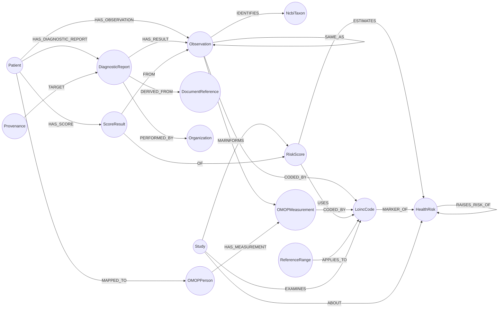

# Local health graph: schema & week-1 proof

What's built (week 1, Nov 11–17): **Klarbefund FHIR R4 Bundles → a local Relate store (`health.rl`) → demo queries**, in Python, with tests. The Swift port (week 2) will write the same graph from the iPhone.

```bash
.venv/bin/python -m health_graph import --db health.rl fixtures/fhir/*.json
.venv/bin/python -m health_graph query --db health.rl trend --param loinc=4548-4
.venv/bin/python -m pytest -q
```

```text
fixtures/fhir/2026-03-12-labor-beispielstadt.json: report rpt-2026-03-12, 7 values (0 Hub-ready)
fixtures/fhir/2026-06-10-praxis-muster.json: report rpt-2026-06-10, 7 values (6 Hub-ready)
fixtures/fhir/2026-09-04-praxis-muster.json: report rpt-2026-09-04, 7 values (6 Hub-ready)
OMOP: omop_persons=1, omop_measurements=18, omop_coded=18
```

## Model



| Layer | Label | Key (unique) | Notable properties |
|---|---|---|---|
| L3 FHIR | `Patient` | `id` | no names, ever; `birthYear` (year only) and `gender` only when the person switches on *Send year of birth and sex* in Klarbefund (for OMOP and risk scores) |
| | `DiagnosticReport` | `resourceId` = `<patient>-<reportId>` | `reportId`, `status`, `effectiveDate`, `performer` |
| | `Observation` | `resourceId` = `<patient>-<reportId>-<n>` | **Hub contract:** `code, display, valueQuantity, unit, referenceLow/High/Text, effectiveDate, category, status, sourceKind, performer, sourceReport, contributedBy`. **Local extras:** `comparator, sourceLine, ocrConfidence, verifiedByPatientAt, originalReading, unmappedReason, hubEligible, repeatedOnReport, duplicateOf` |
| | `DocumentReference`, `Provenance` | `resourceId` | title/created · activity/agent |
| | `Organization` | `name` | the lab or practice |
| L4 OMOP | `OMOPPerson` | `id` = `omop-person-<patient>` | `yearOfBirth`, `genderConceptId` |
| | `OMOPMeasurement` | `id` = `omop-meas-<obs resourceId>` | `measurementConceptId = 0`, `measurementSourceValue` = LOINC, `valueAsNumber`, `unitSourceValue`, `rangeLow/High` |
| L5 Ontology | `LoincCode` | `code` | `display` |
| | `NcbiTaxon` | `code` | `display` (microbiome organisms; LOINC has no term for them) |
| Knowledge | `HealthRisk` | `id` | cardiovascular, diabetes, kidney, liver, bone (osteoporosis), fitness |
| | `RiskScore` | `id` | SCORE2, eGFR (CKD-EPI 2021), FIB-4, TyG; `source`, `demographics`; `USES` the LOINC codes of its inputs |
| | `ReferenceRange` | `analyteKey\|ucum\|sex` | `guidelineLow/High` (official), `optimalLow/High` (lowest-risk band), `basis`, `summary`, `sourceLabel/Url`; from Klarbefund's `reference-ranges.ts`, quoted unchanged |
| | `Study` | `id` | `citation`, `title`, `year`, `design`, `url` (DOI), `pmid`, `pubmedUrl`; the evidence behind a `RAISES_RISK_OF` link, `ABOUT` both risks it connects, `EXAMINES` the markers it measured or recommends, `INFORMS` the risk scores it bears on |
| | `ScoreResult` | `<patient>-<score>` | `value`, `band`, `light`, `computedAt`, `demographics`; `FROM` the exact Observations it used |
| | `Knowledge` | `id` | `fingerprint` of the seeded facts, so seeding runs only when they change |

Files: [`health_graph/schema.cypher`](../health_graph/schema.cypher) (constraints, indexes, 2 full-text indexes) · [`health_graph/omop.cypher`](../health_graph/omop.cypher) · [`health_graph/fhir.py`](../health_graph/fhir.py) (pure parser) · [`health_graph/store.py`](../health_graph/store.py) (writes) · [`health_graph/queries.py`](../health_graph/queries.py).

### Why these names

- **Observation keys and properties copy the Hub's `storeReportRows`** (`ui/src/lib/patient/app-observations.ts` in MinimumViableHealthDataspacev2), *not* the design spec. A later `relate push` of a report's subgraph lands exactly where the app's `POST /api/patient/app/record` would put it.
- **Re-importing a report replaces it** (delete by `sourceReport`, then MERGE), the same rule the Hub uses. Imports are idempotent, and the tests check this.
- **Duplicates are counted once, never deleted.** A value printed twice on one report (microbiome reports list a species in an overview and again in detail) becomes one `Observation` with `repeatedOnReport`. The same measurement in two reports (one sheet scanned twice, or one result printed on two documents of a visit: same LOINC code or printed label, day, value, comparator and unit) stays in both, but one copy is kept and the others get `duplicateOf` and `SAME_AS` to it, preferring the laboratory's digital file over a scan. `trend`, `analytes` and the OMOP transform count the kept copy only; `duplicates` lists the rest. Found in a real graph on Nov 12, 2026: one report scanned twice, two documents of one test day sharing 6 values, a body measurement entered twice, 13 repeated rows on one report.
- **The knowledge layer** (`health_graph/knowledge.py`, `python -m health_graph knowledge`) is the same for everyone and sits next to the person's data: which scores estimate which health risk and from which measures, which measures a guideline names as markers of a risk (each `MARKER_OF` carries its source), and Klarbefund's sourced reference ranges, an official guideline range and, where the source names one, an optimal band. `health_graph/reference_ranges.json` is exported from MinimumViableHealthDataspacev2 with `npm run export:reference-ranges` in `services/epa-ingest`; refresh it there, never edit it here. The range a laboratory printed stays on the Observation and is shown alongside, never replaced.
- **The risks raise each other** (`RAISES_RISK_OF`, query `risk_links`): fatty liver disease and fibrosis raise the risk of cardiovascular disease, type 2 diabetes and CKD; diabetes that of cardiovascular disease, CKD, liver fibrosis and hip fracture; CKD that of cardiovascular disease and bone disease; fitness lowers cardiovascular risk. That is the cardiovascular-kidney-metabolic (CKM) picture of the AHA's 2023 advisory. Each link carries the study's own effect size where there is one (`measure`, `estimate`, `ciLow/High`; observational, so an association, not proof of cause), a plain-language `summary`, and the ids of its `Study` nodes (meta-analyses, pooled cohorts, guidelines, each with its DOI, checked against Crossref, and its PubMed id). Each study also `EXAMINES` the LOINC codes it measured or recommends and `INFORMS` the scores it bears on, so a lab value leads to its evidence in one query (`evidence`, param `loinc`).
- **Score results are stored with their inputs** (`python -m health_graph scores`): a `ScoreResult` points at the exact Observations it used, so "what is my SCORE2 and from which values" is one query.
- **`hubEligible`** applies the Hub's acceptance rules locally (status `preliminary`, LOINC code, number, UCUM unit, date). A `lab-issued-digital` report is `final`, so the Hub's sandbox would refuse it: `0 Hub-ready` above is correct.
- **New in this project** (proposals, not in the Hub yet): `HAS_DIAGNOSTIC_REPORT`, `HAS_RESULT`, `DERIVED_FROM`, `PERFORMED_BY`, `TARGET`, `IDENTIFIES`, `Organization`, `NcbiTaxon`.
- **OMOP transform** is ported from the Hub's `fhir-to-omop-transform.cypher` (plain MERGE/SET, no APOC), but reads `valueQuantity`/`effectiveDate`. The Hub's version reads `value`/`dateTime`, so it currently maps app values to 0 with no date (worth a Hub fix).

## Queries (`python -m health_graph list`)

| Name | Shows |
|---|---|
| `reports` | each report: date, lab, document, source kind, values, Hub-ready count, values also in another report |
| `trend --param loinc=…` | one analyte over time, each measurement once (`alsoInOtherReports` counts the copies), with the printed range, source, patient verification and lab. **No normal/abnormal verdicts** (not a medical device) |
| `analytes` | every coded analyte, how often it was measured, first and last date |
| `duplicates` | values found in more than one report: where the kept copy is and where the copy was found |
| `unmapped` | values without LOINC, with the reason and the NCBI taxon |
| `provenance --param resourceId=…` | the line on the paper, OCR confidence, correction ("30 kg" → 80 kg), document, agent |
| `search --param q=…` | full-text over German labels, source lines **and** LOINC names: `weight` finds *Körpergewicht*, `cholesterol` finds *LDL-Cholesterin* |
| `scores` | stored risk scores with the values each one used, its category and its light |
| `ranges --param loinc=…` | guideline range and optimal band for one LOINC code, with the source |
| `risk --param risk=…` | one health risk: its scores and the markers guidelines name, with the latest value of each |
| `omop` | OMOP CDM measurements |
| `stats` | node counts per label |

Example:

```text
$ python -m health_graph query --db health.rl trend --param loinc=4548-4
| date       | label | value | unit | printedRange | source             | verified | lab                 |
| 2026-03-12 | HbA1c | 5.9   | %    | 4,0 - 6,0    | lab-issued-digital | False    | Labor Beispielstadt |
| 2026-06-10 | HbA1c | 5.6   | %    | 4,0 - 6,0    | ocr-transcribed    | True     | Praxis Dr. Muster   |
| 2026-09-04 | HbA1c | 5.4   | %    | 4,0 - 6,0    | ocr-transcribed    | True     | Praxis Dr. Muster   |
```

## Ask the graph from Claude Code (MCP)

`.mcp.json` also registers **`health-graph`**, a read-only Relate MCP server on `./health.rl` (tools `read_cypher`, `get_schema`). Build the store first with the import command above, then approve the server in `claude`.

## Test data

[`fixtures/fhir/`](../fixtures/fhir/) holds **synthetic data only**: the golden bundle from Klarbefund's own test fixtures (`example-patient`, "Praxis Dr. Muster") plus two reports derived from it by [`fixtures/make_synthetic.py`](../fixtures/make_synthetic.py) to give a time series. **Never put real health data in this repo.**

## Relate notes (learned this week)

- `SEARCH` must follow a `MATCH`: `MATCH (o:Observation) SEARCH o IN (FULLTEXT INDEX … FOR $q LIMIT n) SCORE AS score`.
- Conditional writes use `CALL (x) { WITH x WHERE … MERGE … }` subqueries (no APOC needed).
- `conn.autocommit = False` + `commit()`/`rollback()` makes each report import atomic.
- Constraints, `MERGE … ON CREATE SET`, `UNWIND` over a list of maps, `FOREACH`/`DETACH DELETE`, `left()` and `coalesce()` all work as in Neo4j.
