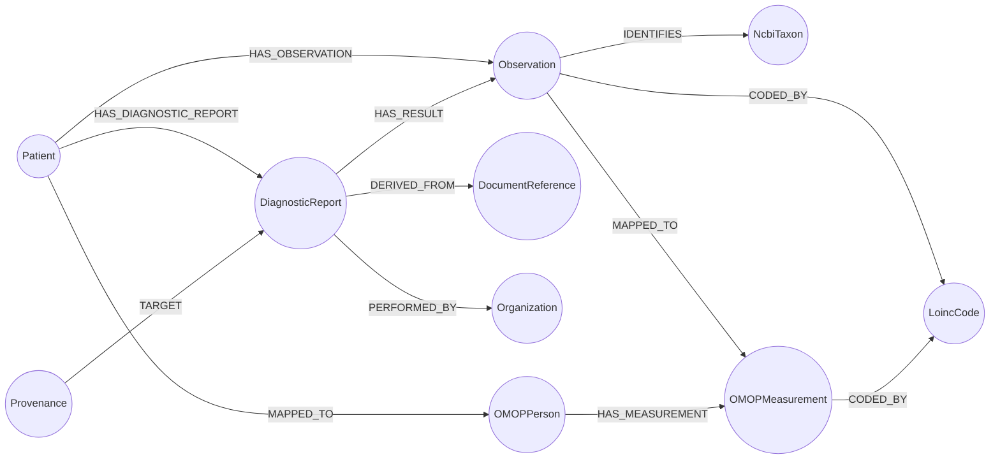

# Local health graph: schema & week-1 proof

What's built (week 1, Nov 11–17): **Klarbefund FHIR R4 Bundles → a local Relate store (`health.rl`) → demo queries**, in Python, with tests. The Swift port (week 2) will write the same graph from the iPhone.

```bash
.venv/bin/python -m health_graph import --db health.rl fixtures/fhir/*.json
.venv/bin/python -m health_graph query --db health.rl trend --param loinc=4548-4
.venv/bin/python -m pytest -q
```

```text
fixtures/fhir/2026-03-12-labor-beispielstadt.json: report rpt-2026-03-12, 7 values (0 Hub-ready)
fixtures/fhir/2026-06-10-praxis-muster.json: report rpt-2026-06-10, 7 values (6 Hub-ready)
fixtures/fhir/2026-09-04-praxis-muster.json: report rpt-2026-09-04, 7 values (6 Hub-ready)
OMOP: omop_persons=1, omop_measurements=18, omop_coded=18
```

## Model



| Layer | Label | Key (unique) | Notable properties |
|---|---|---|---|
| L3 FHIR | `Patient` | `id` | (no names, ever) |
| | `DiagnosticReport` | `resourceId` = `<patient>-<reportId>` | `reportId`, `status`, `effectiveDate`, `performer` |
| | `Observation` | `resourceId` = `<patient>-<reportId>-<n>` | **Hub contract:** `code, display, valueQuantity, unit, referenceLow/High/Text, effectiveDate, category, status, sourceKind, performer, sourceReport, contributedBy`. **Local extras:** `comparator, sourceLine, ocrConfidence, verifiedByPatientAt, originalReading, unmappedReason, hubEligible` |
| | `DocumentReference`, `Provenance` | `resourceId` | title/created · activity/agent |
| | `Organization` | `name` | the lab or practice |
| L4 OMOP | `OMOPPerson` | `id` = `omop-person-<patient>` | `yearOfBirth`, `genderConceptId` |
| | `OMOPMeasurement` | `id` = `omop-meas-<obs resourceId>` | `measurementConceptId = 0`, `measurementSourceValue` = LOINC, `valueAsNumber`, `unitSourceValue`, `rangeLow/High` |
| L5 Ontology | `LoincCode` | `code` | `display` |
| | `NcbiTaxon` | `code` | `display` (microbiome organisms; LOINC has no term for them) |

Files: [`health_graph/schema.cypher`](../health_graph/schema.cypher) (constraints, indexes, 2 full-text indexes) · [`health_graph/omop.cypher`](../health_graph/omop.cypher) · [`health_graph/fhir.py`](../health_graph/fhir.py) (pure parser) · [`health_graph/store.py`](../health_graph/store.py) (writes) · [`health_graph/queries.py`](../health_graph/queries.py).

### Why these names

- **Observation keys and properties copy the Hub's `storeReportRows`** (`ui/src/lib/patient/app-observations.ts` in MinimumViableHealthDataspacev2), *not* the design spec. A later `relate push` of a report's subgraph lands exactly where the app's `POST /api/patient/app/record` would put it.
- **Re-importing a report replaces it** (delete by `sourceReport`, then MERGE), the same rule the Hub uses. Imports are idempotent, and the tests check this.
- **`hubEligible`** applies the Hub's acceptance rules locally (status `preliminary`, LOINC code, number, UCUM unit, date). A `lab-issued-digital` report is `final`, so the Hub's sandbox would refuse it: `0 Hub-ready` above is correct.
- **New in this project** (proposals, not in the Hub yet): `HAS_DIAGNOSTIC_REPORT`, `HAS_RESULT`, `DERIVED_FROM`, `PERFORMED_BY`, `TARGET`, `IDENTIFIES`, `Organization`, `NcbiTaxon`.
- **OMOP transform** is ported from the Hub's `fhir-to-omop-transform.cypher` (plain MERGE/SET, no APOC), but reads `valueQuantity`/`effectiveDate`. The Hub's version reads `value`/`dateTime`, so it currently maps app values to 0 with no date (worth a Hub fix).

## Queries (`python -m health_graph list`)

| Name | Shows |
|---|---|
| `reports` | each report: date, lab, document, source kind, values, Hub-ready count |
| `trend --param loinc=…` | one analyte over time, with the printed range, source, patient verification and lab. **No normal/abnormal verdicts** (not a medical device) |
| `analytes` | every coded analyte, how often it was measured, first and last date |
| `unmapped` | values without LOINC, with the reason and the NCBI taxon |
| `provenance --param resourceId=…` | the line on the paper, OCR confidence, correction ("30 kg" → 80 kg), document, agent |
| `search --param q=…` | full-text over German labels, source lines **and** LOINC names: `weight` finds *Körpergewicht*, `cholesterol` finds *LDL-Cholesterin* |
| `omop` | OMOP CDM measurements |
| `stats` | node counts per label |

Example:

```text
$ python -m health_graph query --db health.rl trend --param loinc=4548-4
| date       | label | value | unit | printedRange | source             | verified | lab                 |
| 2026-03-12 | HbA1c | 5.9   | %    | 4,0 - 6,0    | lab-issued-digital | False    | Labor Beispielstadt |
| 2026-06-10 | HbA1c | 5.6   | %    | 4,0 - 6,0    | ocr-transcribed    | True     | Praxis Dr. Muster   |
| 2026-09-04 | HbA1c | 5.4   | %    | 4,0 - 6,0    | ocr-transcribed    | True     | Praxis Dr. Muster   |
```

## Ask the graph from Claude Code (MCP)

`.mcp.json` also registers **`health-graph`**, a read-only Relate MCP server on `./health.rl` (tools `read_cypher`, `get_schema`). Build the store first with the import command above, then approve the server in `claude`.

## Test data

[`fixtures/fhir/`](../fixtures/fhir/) holds **synthetic data only**: the golden bundle from Klarbefund's own test fixtures (`example-patient`, "Praxis Dr. Muster") plus two reports derived from it by [`fixtures/make_synthetic.py`](../fixtures/make_synthetic.py) to give a time series. **Never put real health data in this repo.**

## Relate notes (learned this week)

- `SEARCH` must follow a `MATCH`: `MATCH (o:Observation) SEARCH o IN (FULLTEXT INDEX … FOR $q LIMIT n) SCORE AS score`.
- Conditional writes use `CALL (x) { WITH x WHERE … MERGE … }` subqueries (no APOC needed).
- `conn.autocommit = False` + `commit()`/`rollback()` makes each report import atomic.
- Constraints, `MERGE … ON CREATE SET`, `UNWIND` over a list of maps, `FOREACH`/`DETACH DELETE`, `left()` and `coalesce()` all work as in Neo4j.
