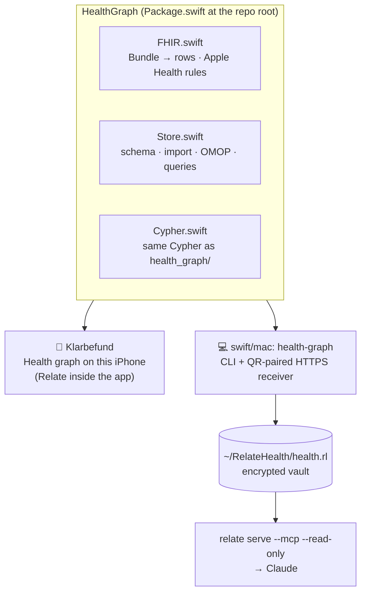
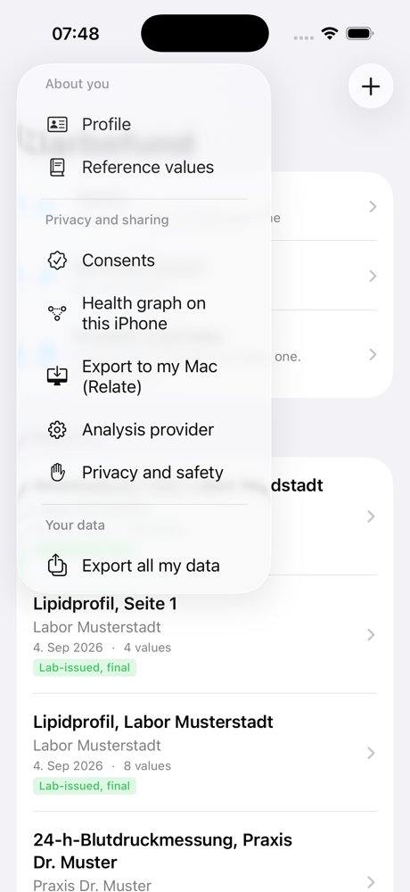
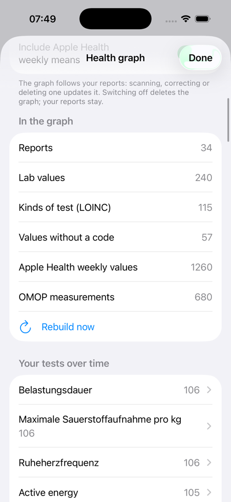
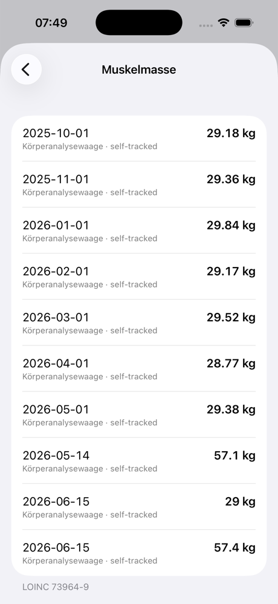

# Swift: one graph library for the iPhone and the Mac

Since Nov 12, 2026 the health graph is built in **Swift** on both sides, with **Relate's Swift package** ([relatedb/relate](https://github.com/relatedb/relate), iOS 16+ / macOS 13+, prebuilt `RelateFFI.xcframework`):



| Part | Where | What it does |
|---|---|---|
| **HealthGraph** library | [`Package.swift`](../Package.swift), [`swift/Sources/HealthGraph`](../swift/Sources/HealthGraph) | FHIR R4 Bundle → graph rows (Hub keys, provenance, unmapped values with their reason), Apple Health weekly-mean rules, schema, report replace, OMOP transform, the 9 named queries. Depends only on Relate. |
| **health-graph** CLI + receiver | [`swift/mac`](../swift/mac) | `import`, `query`, `list`, `receive`. The receiver: SwiftNIO + TLS 1.2+, X.509 v3 P-256 certificate (swift-certificates), SHA-256 pin in the QR code, bearer token, private-network clients only, one writer at a time. |
| **Health graph on this iPhone** | Klarbefund, `OnDeviceGraph.swift` / `OnDeviceGraphView.swift` | The same graph, built on the phone from the reports (and optionally Apple Health), queried with Cypher on the phone. |

The Python package in [`health_graph/`](../health_graph) stays as the **reference**: the Swift tests check the same fixtures with the same expected numbers, and a parity test fails if the Cypher in Swift and Python drifts apart.

## Same graph, checked

| Check | Result |
|---|---|
| `swift test` (HealthGraph, macOS) | **23 tests pass**: parsing, Hub ids, Apple Health rules (14 metrics, plausibility, duplicates), counts, re-import replaces, trend, comparator, unmapped, provenance, full-text search (German labels and LOINC names), OMOP, wearables meeting lab values on one LOINC code, read-only never creates a store, Cypher parity with `health_graph/` |
| Same package in the **iOS Simulator** (`xcodebuild test`) | passes: Relate runs on iOS |
| `swift test --package-path swift/mac` | **12 tests pass**: HTTPS through Apple's own TLS (`URLSession`) with the pinned certificate, token required, record → wearables, re-send replaces, a stalled client blocks nobody, concurrent sends, non-Bundle refused, pairing link round trip, v3 named-curve certificate, private-network rule, mount check, the QR code decodes to the link |
| CLI output vs Python | identical tables for the same store (only `true`/`false` casing differs) |
| Existing pairing | the Swift receiver loads the Python receiver's certificate and token from `~/.config/relate-health-graph`: same fingerprint, so a paired iPhone keeps working without a new scan |
| Real receiver | runs from the encrypted vault (`scripts/health_vault.sh receive`), reachable over Wi-Fi |

## On the Mac

```bash
scripts/health_vault.sh receive          # builds, signs and starts the Swift receiver in the encrypted vault
```

Or by hand, without the vault:

```bash
swift run -c release --package-path swift/mac health-graph receive --db health.rl
swift run -c release --package-path swift/mac health-graph import --db demo.rl fixtures/fhir/*.json
swift run -c release --package-path swift/mac health-graph query --db demo.rl trend --param loinc=4548-4
```

`HEALTH_GRAPH_RECEIVER=python scripts/health_vault.sh receive` still starts the Python receiver.

**Local Network permission (macOS 15+).** macOS lets an app talk to devices on the Wi-Fi only after you allow it, and it remembers that by the app's code signature. `swift build` signs ad hoc, which is a new identity on every build, so `health_vault.sh` signs the binary with your Apple Development certificate as `red.mabu.health-graph` (override with `RELATE_HEALTH_SIGN=<identity>`). The first time, macOS asks once to use the key (Keychain: *Always Allow*) and once for local network access (*Allow*). Symptom without it: the receiver answers on `127.0.0.1` but connections from the iPhone hang in the TLS handshake.

## On the iPhone: Health graph on this iPhone

Klarbefund → **Menu → Privacy and sharing → Health graph on this iPhone**.

  

*(iOS Simulator, Klarbefund's fictional dev dataset.)*

- **Built on the phone** from the same FHIR bundles "Export to my Mac" sends, so the phone's graph and the Mac's graph are the same model (Patient, DiagnosticReport, Observation, LoincCode, NcbiTaxon, Provenance, OMOP).
- **Rebuilt from scratch** whenever the reports change (scan, correct, delete), so it never holds a value the app no longer has.
- **Optional Apple Health weekly means**, the same 14 metrics as the Mac export.
- **Questions are Cypher on the phone**: counts, every test with how often it was measured, each test over time with where every value came from (`trend`), and the values without a code with the reason (`unmapped`).
- **Encryption at rest:** the store is in the app's Application Support folder under iOS Data Protection class `complete` (unreadable while the phone is locked), excluded from iCloud/iTunes backup, and nothing leaves the phone. Switching the feature off deletes the graph; the reports stay.
- Demo and dev-data launches keep their graph in a separate folder, so fictional data never meets a real graph.

Fictional dev dataset in the Simulator: **34 reports, 240 lab values, 106 kinds of test, 57 values without a code, 155 OMOP measurements**; with Apple Health on, **+1260 weekly values** and the watch's metrics join the lab's on the same LOINC codes (115 kinds of test, 680 OMOP measurements). Building took about 3 seconds.

**App size:** Relate is a static library, so only what the app calls is linked. Klarbefund Release for device grows from **8.3 MB to 30 MB** (binary 4.8 → 27 MB, uncompressed; the App Store download is compressed). The 162 MB `ios-arm64` archive in the XCFramework is not what ships.

## Using HealthGraph in an app

```swift
// Package.swift / project.yml: https://github.com/ma3u/relate-hackathon-team (product HealthGraph)
import HealthGraph

let store = try HealthStore(path: url.path)        // one handle per store per process
try store.initSchema()
let (stored, parsed) = try store.receiveReport(try JSON.object(bundleData), reportId: reportUUID)
try store.receiveWearables(try JSON.object(appleHealthBundle))
let trend = try store.rows(query: "trend", ["loinc": "4548-4"])   // [[String: String]]
```

Relate keeps **one open handle per store per process**: release a writer before opening the same store read-only (it closes when the `HealthStore` is released). Klarbefund pins the package to a commit in `project.yml`, so a TestFlight build always contains the same graph code.

## Lessons learned

- **The first `swift build` downloads a 311 MB XCFramework** (all slices: macOS, iOS device, Simulator). In a sandbox, or when it stalls, download it once and seed SwiftPM's cache: `~/Library/Caches/org.swift.swiftpm/artifacts/https___github_com_relatedb_relate_releases_download_v1_0_0_RelateFFI_xcframework_zip` (checksum `a787caf0…0566`, as in Relate's `Package.swift`).
- **Writer and reader in one process:** opening a read-only `Database` while a writer on the same file is open fails with `internal error`. Close the writer first.
- **Two packages, not one:** the iPhone app depends on the root package (HealthGraph + Relate only). The Mac CLI lives in `swift/mac`, so Klarbefund never fetches SwiftNIO, swift-certificates or ArgumentParser.
